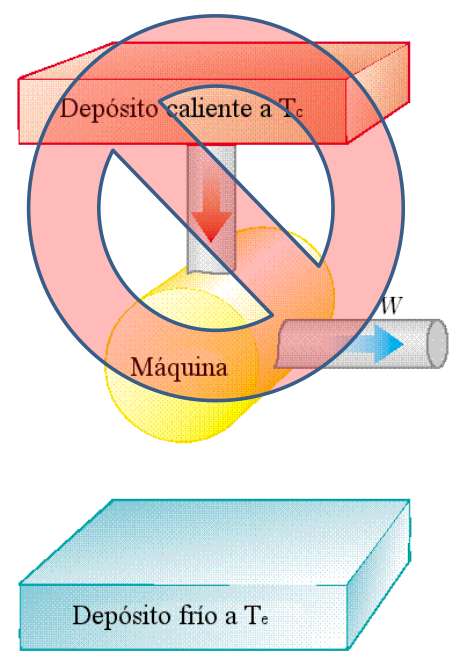

# Segundo principio. Introducción y enunciado de Kelvin–Planck

> Fuente: `2019/3er Parcial/2018 UT XVI - Principios de la Termodinámica.pdf`,
> páginas 24, 25, 26, 27. SHA-256:
> `dc2644f583b907ef2bdf7d3841e6e39009b5e41d2b9f8fdf64d02a47287f5df4`. Nombre
> 2018 y carpeta 2019; sin fecha de clase impresa. Extracción PyMuPDF4 LLM y
> Poppler, cotejo visual y recuperación de figuras originales. Se preservan las
> convenciones y erratas.

## Introducción

- Primer Principio: establece la conservación de la energía
- La experiencia demuestra que no todas las transformaciones energéticas
  permitidas por el Primer Principio suceden en la realidad
- Es necesario formular un Segundo Principio de la Termodinámica que nos informe
  acerca de los procesos que son posibles en la naturaleza y los que no lo son.

El Segundo Principio admite muchas formulaciones diferentes, todas ellas
equivalentes.

Nosotros abordaremos su estudio desde el punto de vista más afín a la
ingeniería: las máquinas térmicas

## Necesidad del Segundo Principio

Sistema: Un cuerpo caliente en contacto con uno más frío

| Proceso permitido | Proceso no permitido |
| -- | -- |
| El cuerpo caliente cede parte de su energía interna al cuerpo frío en forma de calor. | El cuerpo frío cede parte de su energía interna al cuerpo caliente en forma de calor. |

Ambos procesos son permitidos por el Primer Principio, pero solamente el primero
de ellos es “natural”.

La falta de simetría en el papel del calor y el trabajo como formas de
transferencia de energía y la existencia de una dirección “privilegiada” para
los procesos reales no se infieren del primer principio de la Termodinámica

## Segundo Principio

Es imposible construir una máquina térmica que, trabajando cíclicamente, sólo
produzca el efecto de absorber energía de un foco y convertirla en igual
cantidad de trabajo(enunciado de Kelvin–Planck)

Si queremos extraer energía de un foco térmico para producir trabajo siempre
debemos ceder parte de esa energía a otro foco más frío.

Es decir, es imposible construir una máquina térmica con $`\varepsilon=1`$.

CUIDADO: no es una limitación técnica, sino teórica.
