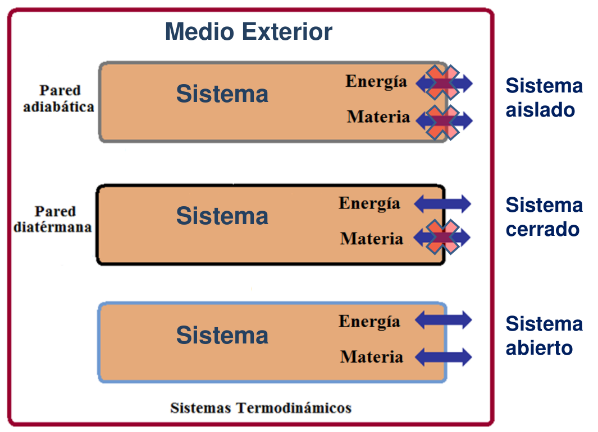
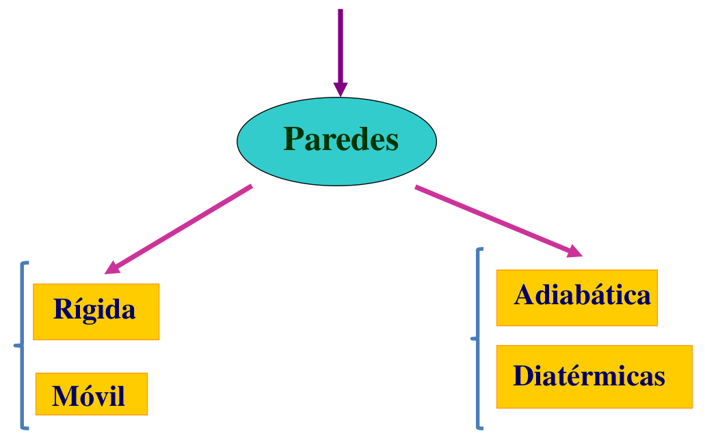

# Sistemas, medio, límites y clasificación

> Fuente: `2019/3er Parcial/2018 UT XV Introducción a la Termodinámica.pdf`,
> páginas 5, 6, 7, 8, 10. SHA-256:
> `0c255d1c462cf23cf43e89eb6031d28084ef096c4512689fc85322d752c7b15c`. Nombre
> 2018, carpeta 2019; sin fecha de clase impresa. Extracción PyMuPDF4 LLM y
> Poppler, cotejo visual de las páginas originales y recuperación de figuras. Se
> preservan las erratas y preguntas sin resolver.

Algunos conceptos SISTEMA: Un sistema termodinámico esta constituido por cierta
cantidad de materia o radiación en una zona del espacio limitada por una
superficie cerrada, material o inmaterial, en el que se distingue:

- Interior: el propio sistema

- Medio exterior: aquello que sin formar parte del sistema, lo rodea y puede (o
  no) realizar intercambios de energía y materia con él.

- Límite: superficie material o inmaterial que separa el sistema del medio
  exterior. Paredes. Cuando un sistema está dentro de otro, se dice que es un
  subsistema.

Clasificación por la naturaleza de sus paredes

Los sistemas termodinámicos pueden ser :

- Abierto: puede intercambiar energía y materia con el medio exterior. Ej: un
  ser vivo, una máquina de vapor que recibe y expulsa vapor.

- Cerrado: puede intercambiar energía pero no materia con el medio exterior. Ej:
  gas encerrado en una bomba, un vaso de agua tapado. Su masa permanece
  constante. Pared diatérmana.

- Aislado: no puede intercambiar ni energía ni materia con el medio exterior.
  Ejemplo: un termo. Pared adiabática

## Sistemas

¿Qué separa el sistema de los alrededores?

Paredes

- Rígida
- Móvil
- Adiabática
- Diatérmicas

Sistemas: Clasificación según su contenido

- Un sistema es homogéneo cuando sus propiedades físicas y químicas
  macroscópicas son iguales en todos sus puntos (ej.: un gas o una disolución
  diluida)

- Un sistema es heterogéneo cuando está formado por subsistemas homogéneos
  llamados fases (ej.: disolución saturada; líquido en equilibrio con su vapor).
