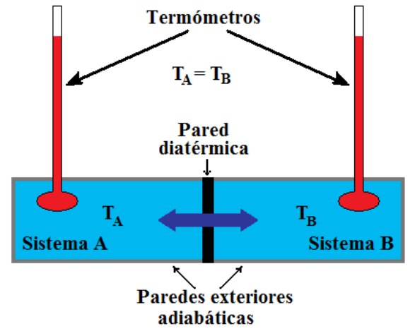

# Concepto de temperatura y equilibrio térmico

> Fuente: `2019/3er Parcial/2018 UT XV Introducción a la Termodinámica.pdf`,
> páginas 4, 24, 25. SHA-256:
> `0c255d1c462cf23cf43e89eb6031d28084ef096c4512689fc85322d752c7b15c`. Nombre
> 2018, carpeta 2019; sin fecha de clase impresa. Extracción PyMuPDF4 LLM y
> Poppler, cotejo visual de las páginas originales y recuperación de figuras. Se
> preservan las erratas y preguntas sin resolver.

Qué es la temperatura?

- Es una propiedad de un sistema que determina si este se halla en equilibrio
  térmico con otros sistemas.

- Es una medida del estado de equilibrio termodinámico de un sistema

- Sistema

- Estado

- Estado de equilibrio

- Cómo se mide?

Concepto de temperatura. Equilibrio térmico.

- La temperatura de un sistema es una propiedad que determina si un sistema se
  encuentra o no en equilibrio térmico con otros sistemas.

- Dos sistemas estarán en equilibrio térmico si y solo si tienen la misma
  temperatura.

Temperatura y Equilibrio Térmico

- Temperatura es una medida de la energía cinética de los átomos o moléculas que
  constituyen un objeto material cualquiera.

- Su medida se realiza a través de los cambios que experimentan algunas
  magnitudes físicas, cuando los cuerpos son sometidos a intercambios de energía
  térmica.

- Ejemplos de estas magnitudes son: el volumen, la presión, la resistencia
  eléctrica, y muchas otras que han dado lugar a diferentes formas de medir la
  temperatura.
