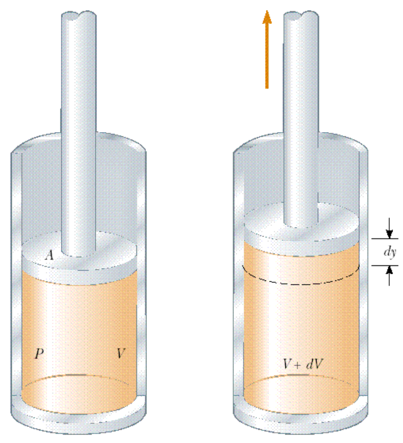
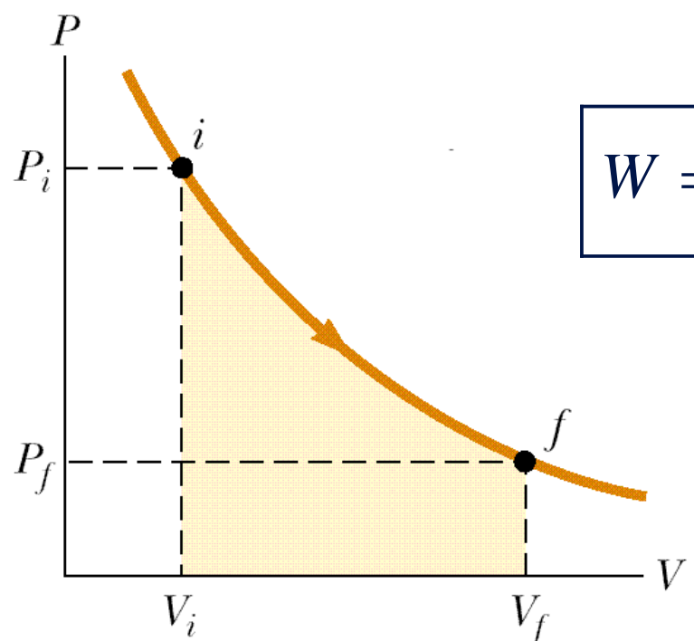
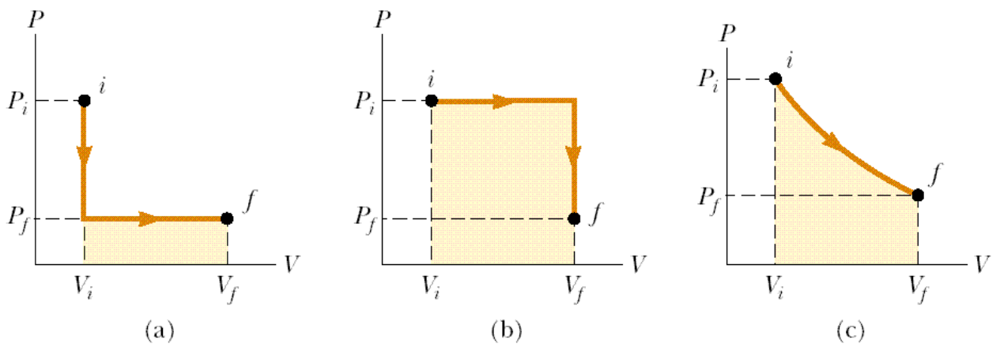

# Trabajo exterior y dependencia de la trayectoria

> Fuente: `2019/3er Parcial/2018 UT XVI - Principios de la Termodinámica.pdf`,
> páginas 3, 4, 5, 6, 8. SHA-256:
> `dc2644f583b907ef2bdf7d3841e6e39009b5e41d2b9f8fdf64d02a47287f5df4`. Nombre
> 2018 y carpeta 2019; sin fecha de clase impresa. Extracción PyMuPDF4 LLM y
> Poppler, cotejo visual y recuperación de figuras originales. Se preservan las
> convenciones y erratas.

Trabajo exterior

- Se puede definir como trabajo exterior realizado por o sobre el sistema, a
  todo desplazamiento sufrido por éste contra o por la acción de fuerzas
  exteriores (del medio ambiente exterior).

- En Termodinámica, por convención, se da el signo positivo al trabajo realizado
  por el sistema sobre el medio exterior y el signo negativo al trabajo
  realizado sobre el sistema por el medio exterior.

## Trabajo y Calor

```math
P=F/A=\text{presión}
```

Entonces $`F=P\cdot A`$

El volumen se expande



```math
dW=\vec F\cdot d\vec r=F\vec j\cdot dy\,\vec j
```

```math
dW=F\,dy=PA\,dy
```

```math
dW=P\,dV
```

```math
W=\int_{V_i}^{V_f}P\,dV
```

Trabajo realizado por el sistema

## Representación del trabajo



```math
W=\int_{V_i}^{V_f}P\,dV
```

## Trabajo en distintas transformaciones



(a)

```math
W=P_f(V_f-V_i)
```

(b)

```math
W=P_i(V_f-V_i)
```

(c)

```math
W=\int_{V_i}^{V_f}P(V)\,dV
```

El trabajo depende de los estados inicial y final y de la trayectoria.

RESUMIENDO

- Tanto el trabajo realizado entre dos estados como el calor cedido o recibido
  dependen de los estados inicial, final e intermedios del sistema, es decir
  depende de la trayectoria entre los estados inicial y final.
