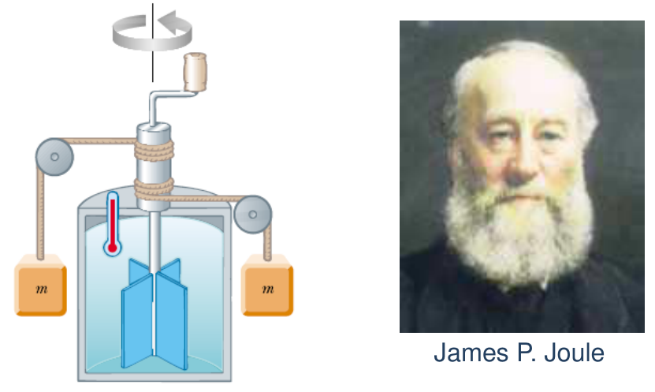
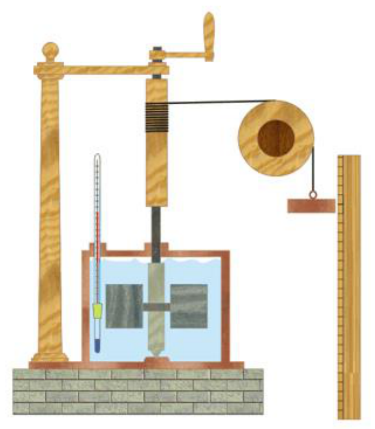

# Unidades de calor y equivalente mecánico

> Fuente: `2019/3er Parcial/2018 UT XV Introducción a la Termodinámica.pdf`,
> páginas 46, 47, 48. SHA-256:
> `0c255d1c462cf23cf43e89eb6031d28084ef096c4512689fc85322d752c7b15c`. Nombre
> 2018, carpeta 2019; sin fecha de clase impresa. Extracción PyMuPDF4 LLM y
> Poppler, cotejo visual de las páginas originales y recuperación de figuras. Se
> preservan las erratas y preguntas sin resolver.

## UNIDADES DE CALOR

Esto hace necesario distinguir entre el concepto de temperatura y cantidad de
calor. Es natural suponer de que el cuerpo que produjo el mayor aumento de
temperatura es el que "tenía" mayor cantidad de calor.

La unidad clásica para medir la cantidad de calor es la caloría. Se define como:

Caloría: la cantidad de energía necesaria para elevar la temperatura de un gramo
de agua de 14,5 a 15,5°C a la presión normal. La designamos con cal.

Como esta es una unidad relativamente pequeña, frecuentemente se emplea la
kilocaloría

```math
1\mathrm{Kcal}=1000\,\mathrm{cal},\qquad1C=1\mathrm{Kcal},\qquad1\mathrm{cal}=4.186\mathrm J
```

Unidad Térmica Británica: cantidad de energía necesaria para elevar la
temperatura de una libra de agua de 63ºF a 64ºF. La designamos con BTU.

En el Sistema Internacional la unidad de energía, trabajo y cantidad de calor es
el Joule. **No confundir, trabajo y calor no son energía, son formas de
transferencia de energía.**

## Equivalente mecánico del calor



James P. Joule

Experiencia de Joule para determinar el equivalente mecánico del calor. Los
bloques que descienden hacen girar las paletas que agitan el agua, aumentando su
temperatura. La variación de la energía potencial de los bloque es proporcional
a la variación de temperatura del agua.

```math
1\,\mathrm{cal}=4{,}186\,\mathrm J
```



## Observaciones de transcripción

Se conservan «1 C=1 Kcal», «los bloque» ylas variantes de punto/coma decimal de
las dos páginas.
