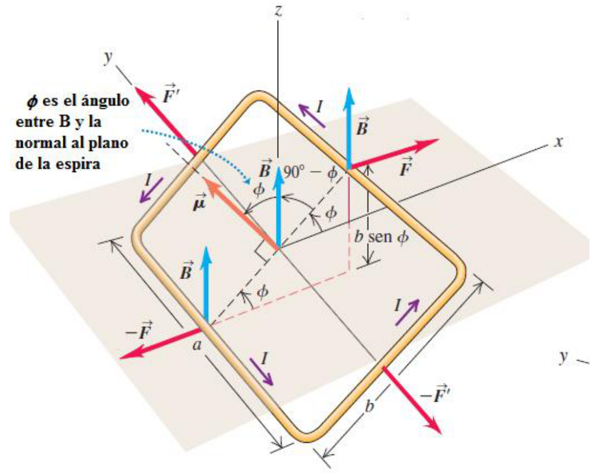
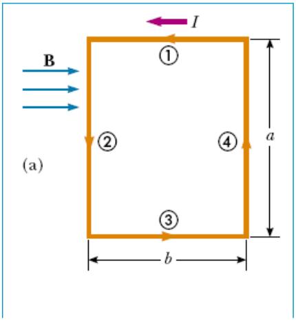
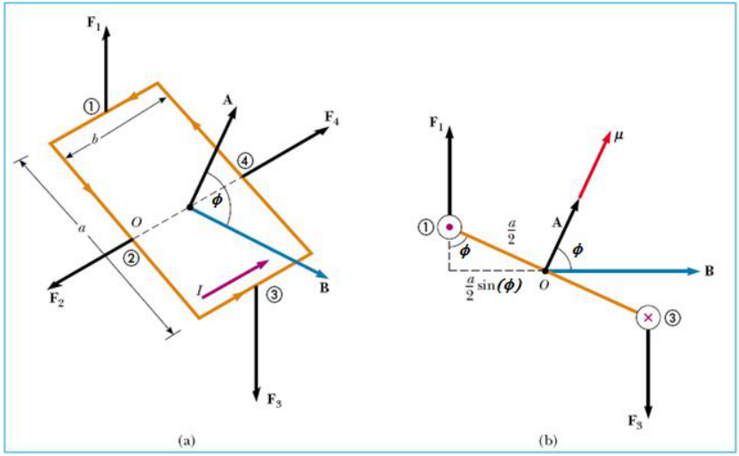
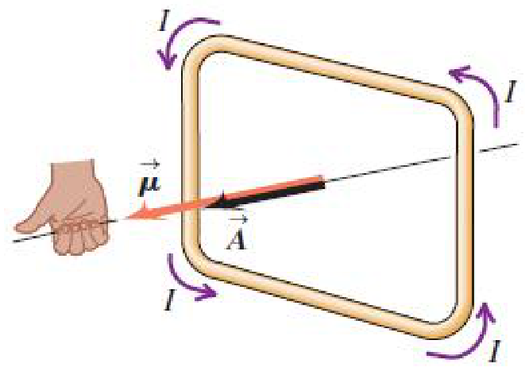
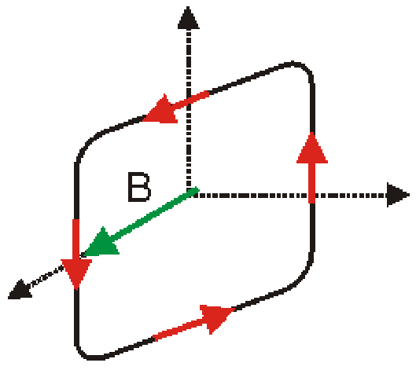
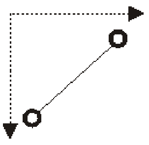

# Torque sobre una espira y momento dipolar — variante impresa

Unidad Temática V — Fuerzas Magnéticas sobre cargas y elementos de corriente



φ es el ángulo entre B y la normal al plano de la espira

## Acción del campo magnético sobre un circuito plano


a) Las fuerzas que actúan sobre la espira se cancelan entre sí, por tanto la
fuerza neta es nula. Las fuerzas que actúan sobre los lados a de la espira
producen un torque

La fuerza neta sobre una espira por la que circula corriente en un campo
magnético uniforme es nula. Pero sobre ella actúa un torque neto que en general
es distinto de cero.

## Momento magnético

Campo magnético en el plano de la espira



```math
F_2=F_4=IaB
```

```math
t_{max}=F_2\frac b2+F_4\frac b2=IabB=IAB
```

```math
A=ab
```

Área de la espira



B forma un ángulo θ con la perpendicular al plano de la espira

```math
F_1=F_3=IbB
```

```math
t=F_1\frac a2\mathop{\mathrm{sen}}\nolimits(f)+F_3\frac a2\mathop{\mathrm{sen}}\nolimits(f)=IbaB\mathop{\mathrm{sen}}\nolimits(f)=IAB\mathop{\mathrm{sen}}\nolimits(f)
```

```math
\vec{t}=I\vec A\times\vec B\qquad\vec{m}=I\vec A
```

momento dipolar magnético

```math
\vec{t}=\vec{m}\times\vec B\qquad t=m B\mathop{\mathrm{sen}}\nolimits(f)
```

módulo



La regla de la mano derecha determina la dirección del momento magnético de una
espira por la que circula una corriente I

Torque

```math
\vec{t}=I\vec A\times\vec B\qquad\vec{m}=I\vec A
```

momento magnético

```math
\vec{t}=\vec{m}\times\vec B\qquad t=m B\mathop{\mathrm{sen}}\nolimits(f)
```

## Preguntas

Hacia dónde apunta la fuerza magnética?

Hacia dónde apunta el vector momento dipolar magnético?

Cómo gira la espira?





Fin de la Clase

## Procedencia y diferencias de esta versión

- Original: `2019/2do Parcial/UT 5 4 pag.pdf`, páginas 8, 9, 10 de 11,
  diapositivas 32–38. SHA-256:
  `134d9de661dcefd039d315a0e669b89c38bf02859d1d2d0806f15569b5006764`.
- El año corresponde a la carpeta; no consta fecha impresa en este tramo.
- Todas las diapositivas del tramo cotejadas visualmente. OCR español sobre una
  copia y extracción Poppler/PyMuPDF4LLM como apoyo; sus símbolos no se aceptan
  automáticamente. Figuras y etiquetas cotejadas con los medios de la versión
  individual, que se reutilizan sin redibujar ni completar.
- En las fórmulas se conservan las letras t para torque, m para momento dipolar
  y f como argumento de sen. Las figuras conservan sus símbolos mu y phi; el
  texto de la diapositiva 35 usa theta. No se uniforma la notación.
- Las tres preguntas de la diapositiva 37 carecen de respuesta. La 38 solo
  contiene «Fin de la Clase» y se conserva como cierre.
- Comparación: [versión individual](torque-espira-momento-dipolar-2019.md).
