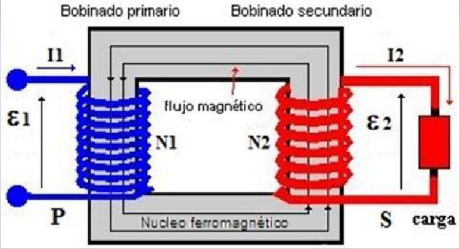
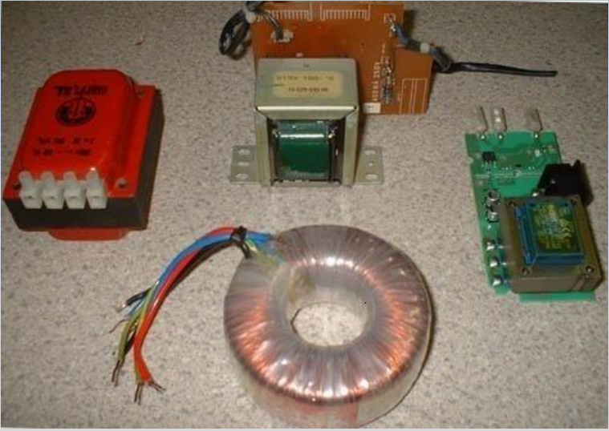
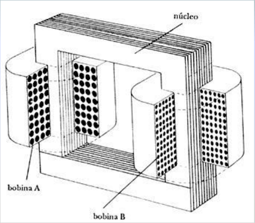
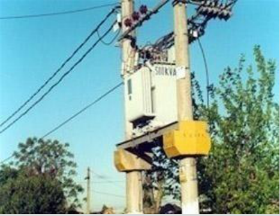
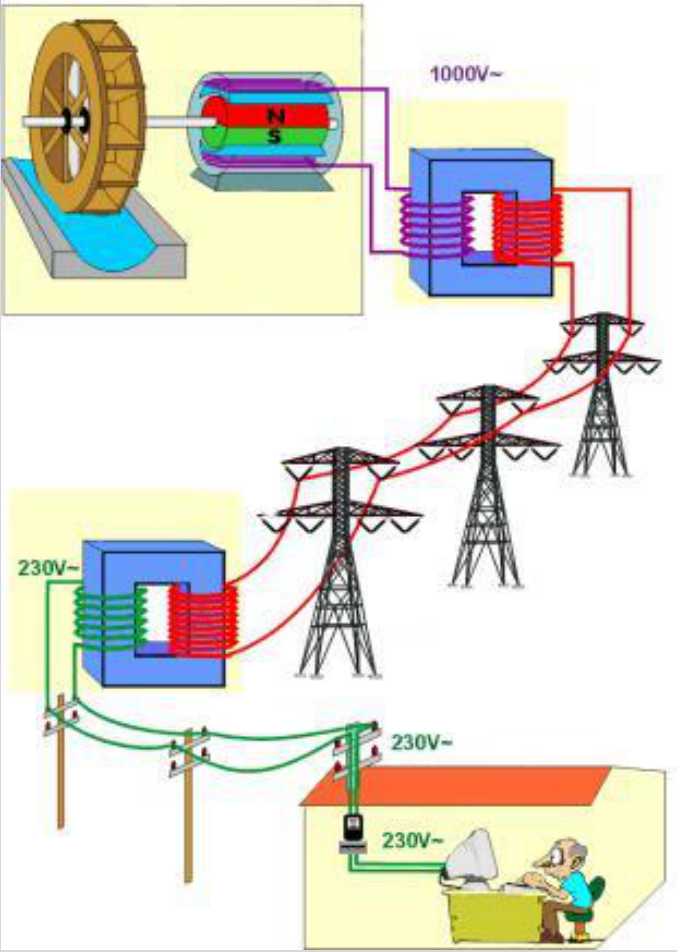

# Transformadores y transmisión de energía: versión Electromagnetismo

Unidad Temática VII — Electromagnetismo

## Transformadores: elevadores y reductores de tensión

- Los fenómenos de la autoinducción y de la inducción mutua constituyen el
  fundamento del transformador eléctrico, un aparato que permite elevar o
  reducir tensiones alternas.
- Un transformador consta, en esencia, de dos bobinas arrolladas a un mismo
  núcleo ferromagnético (generalmente hierro dulce laminado), de manera que casi
  todo el flujo magnético que produce una de las bobinas atraviesa también la
  otra.
- La bobina o arrollamiento donde se aplica la f.e.m. alterna exterior recibe el
  nombre de primario (P) y la bobina en donde la f.e.m. aparece ya transformada
  se denomina secundario (S).



La perdida de energía por disipación de calor debido a la resistencia de las
bobinas es pequeña.

Un transformador típico tiene una eficiencia del 90 al 99%.

En lo que sigue consideramos al transformador con eficiencia 100%. Cuando al
primario se le aplica una fuerza electromotriz alterna, el flujo magnético
variable que produce atraviesa tanto al primario como al secundario. Si N₁ es el
número de espiras del primario y N₂ el del secundario, de acuerdo con la ley de
Faraday-Henry, resultará para el primario y secundario las fuerzas
electromotrices auto inducidas:

```math
\varepsilon_1=-N_1\frac{d\Phi_B}{dt}\quad\text{y}\quad\varepsilon_2=-N_2\frac{d\Phi_B}{dt}
```

Combinando estas ecuaciones

```math
\frac{\varepsilon_1}{N_1}=\frac{\varepsilon_2}{N_2}
```

Esta expresión puede escribirse para un transformador ideal en la forma:

```math
\frac{V_1}{N_1}=\frac{V_2}{N_2}\Rightarrow\frac{V_1}{V_2}=\frac{N_1}{N_2}
```

Ecuación del Transformador

Razón de transformación

```math
\left(\frac{N_1}{N_2}\right)
```

```math
V_1\gt V_2\Rightarrow\text{Reductor o transformador de baja}
```

```math
V_1\lt V_2\Rightarrow\text{Elevador o transformador de alta}
```

En la práctica, como consecuencia de las resistencias de los circuitos
correspondientes, la tensión V₁ aplicada al primario es algo mayor que la f.e.m.
inducida ε₁ y la tensión V₂ que resulta en el secundario es algo menor que la
f.e.m. ε₂ inducida en él.

En los transformadores comerciales el rendimiento es muy elevado, => se pierde
poca energía en el proceso de transformación, por lo que la potencia eléctrica
en el primario puede considerarse aproximadamente igual que en el secundario, es
decir:

```math
\varepsilon_1I_1=\varepsilon_2I_2\Rightarrow\frac{\varepsilon_2}{\varepsilon_1}=\frac{I_1}{I_2}
```

La intensidad de corriente es inversamente proporcional a la tensión







Arriba a izquierda transformadores que se utilizan en fuentes de PCs, TVs, etc,
y a derecha un corte. Abajo un transformador de la red de distribución
domiciliaria.

Los transformadores son fundamentales en el transporte de energía eléctrica.
Normalmente entre la central eléctrica (Yaciretá) y los centros de consumo
(Bs.As.) hay una distancia de cientos de km., perdiéndose energía por efecto
Joule en las líneas de conducción. Si P es la potencia generada, la potencia P’
que llega a los centros de consumo será:

```math
P'=P-RI^2=\varepsilon I-RI^2
```

Para que la perdida de energía sea mínima debemos hacer que el termino R I² sea
lo más pequeño posible. Esto se logra utilizando conductores gruesos de poca
resistencia por unidad de longitud, y transportando la corriente a alta tensión,
de manera que la intensidad de corriente sea muy pequeña. Se produce a baja
tensión, se transporta en líneas de alta tensión (hasta 500.00 Volts), y en el
lugar de consumo se transforma a 220 V. Esto es posible gracias a los
transformadores



En la figura de la izquierda se presenta un esquema de la generación, elevación,
transmisión y transformación a baja de la tensión para la distribución en la red
domiciliaria.

## Ejemplo: Resistencia

Veamos un ejemplo. Resistencia tiene 400.000 habitantes, y cada uno de ellos
consume en promedio una potencia de 1,5kW. La corriente que se necesita para
cada persona es de:

```math
P=VI\Rightarrow I=\frac PV=\frac{1500W}{220V}=6{,}8A
```

La corriente total necesaria para Resistencia sería

```math
I=400.000\times6{,}8A=2.720.000A
```

¿Que hacemos? En vez de transportar la potencia con V = 220Volts, con un
transformador de alta lo hacemos a 500.000 V, con lo que la corriente en la
linea de trasmisión será

```math
P_1=P_2\Rightarrow V_1I_1=V_2I_2
```

```math
I_1=\frac{V_2}{V_1}I_2=\frac{220}{500.000}2.720.000=1196{,}8A
```

## Ejemplo: pérdidas de potencia

Ejemplo: A Una ciudad pequeña se envía un promedio de 120 kW de energía
eléctrica desde una usina ubicada a 10 km de distancia. Las líneas de trasmisión
tienen una resistencia total de 0,40Ω. Calcule la pérdida de potencia si la
energía se trasmite a a) 240V y b) 24.000V.

a)

```math
I=P/V=120.000W/240V=500A
```

```math
P=RI^2=(500A)^2\,0{,}4\Omega=100.000W
```

b)

```math
I=P/V=120.000W/24000V=5A
```

```math
P=RI^2=(5A)^2\,0{,}4\Omega=10W
```

Fin de la Clase

## Procedencia y observaciones de transcripción

- Original: `2019/2do Parcial/2019 UT VII Electromagnetismo.pdf`, páginas 53–62
  de 62. No consta fecha impresa; 2019 es del nombre del archivo.
- SHA-256: `eff3447774cadfcb2726a6caabbe8e257782276fce3e67dda465673d5ef67a6a`.
- Herramientas: PyMuPDF4LLM, Poppler y recortes PyMuPDF; páginas, expresiones y
  figuras del tramo cotejadas visualmente.
- Se conservan «500.00 Volts» de página58 frente a 500.000 V del ejemplo de
  página60, y 220 V del texto frente a 230V de la figura. Las soluciones
  numéricas de páginas60 y61 pertenecen al original. La página62 dice «Fin de la
  Clase».
