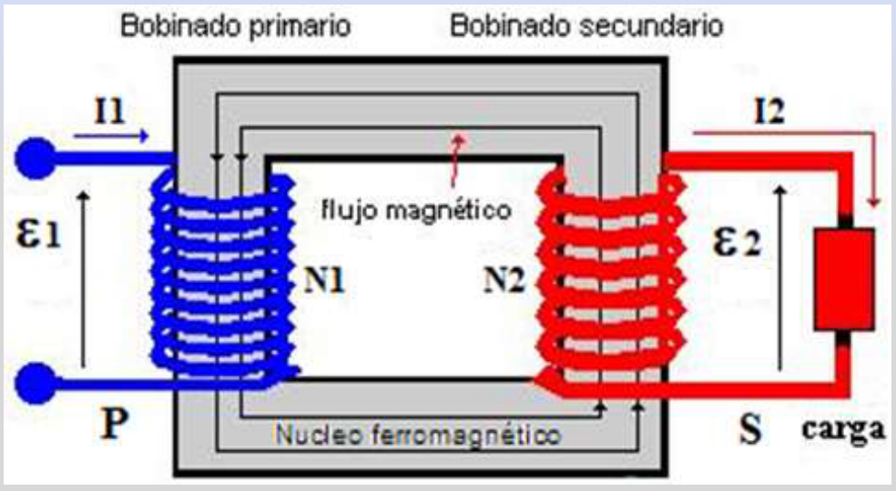
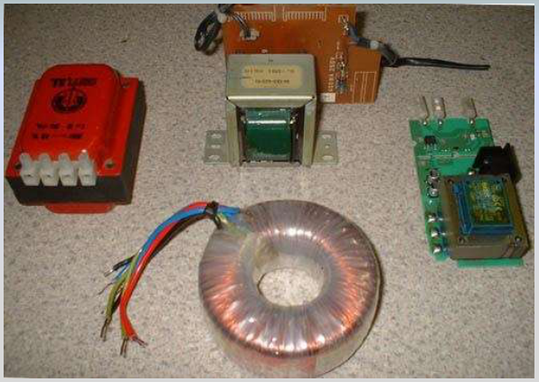
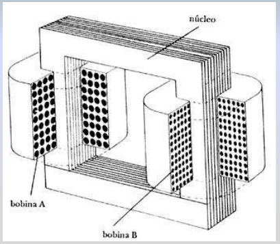
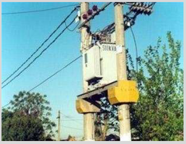
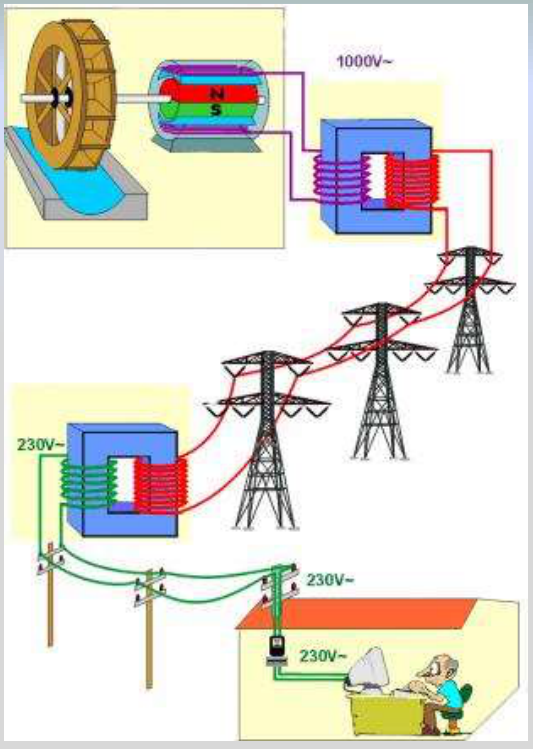

# Transformadores y transmisión de energía

Unidad Temática VII — Electromagnetismo

## Transformadores: elevadores y reductores de tensión



- Los fenómenos de la autoinducción y de la inducción mutua constituyen el
  fundamento del transformador eléctrico, un aparato que permite elevar o
  reducir tensiones alternas.
- Un transformador consta, en esencia, de dos bobinas arrolladas a un mismo
  núcleo ferromagnético (generalmente hierro dulce laminado), de manera que casi
  todo el flujo magnético que produce una de las bobinas atraviesa también la
  otra.
- La bobina o arrollamiento donde se aplica la f.e.m. alterna exterior recibe el
  nombre de primario (P) y la bobina en donde la f.e.m. aparece ya transformada
  se denomina secundario (S).


La perdida de energía por disipación de calor debido a la resistencia de las
bobinas es pequeña.

Un transformador típico tiene una eficiencia del 90 al 99%.

En lo que sigue consideramos al transformador con eficiencia 100%. Cuando al
primario se le aplica una fuerza electromotriz alterna, el flujo magnético
variable que produce atraviesa tanto al primario como al secundario. Si N₁ es el
número de espiras del primario y N₂ el del secundario, de acuerdo con la ley de
Faraday-Henry, resultará para el primario y secundario las fuerzas
electromotrices auto inducidas:

```math
\varepsilon_e=-N_e\frac{d\Phi}{dt}\quad\text{y}\quad\varepsilon_s=-N_s\frac{d\Phi}{dt}
```

Combinando estas ecuaciones

```math
\frac{\varepsilon_e}{N_e}=\frac{\varepsilon_s}{N_s}
```

Esta expresión puede escribirse para un transformador ideal en la forma:

```math
\frac{V_e}{N_e}=\frac{V_s}{N_s}\Rightarrow\frac{V_e}{V_s}=\frac{N_e}{N_s}
```

Ecuación del Transformador

Razón de transformación

```math
\left(\frac{N_e}{N_s}\right)
```

```math
V_e\gt V_s\Rightarrow\text{Reductor o transformador de baja}
```

```math
V_e\lt V_s\Rightarrow\text{Elevador o transformador de alta}
```

En la práctica, como consecuencia de las resistencias de los circuitos
correspondientes, la tensión V₁ aplicada al primario es algo mayor que la f.e.m.
inducida ε₁ y la tensión V₂ que resulta en el secundario es algo menor que la
f.e.m. ε₂ inducida en él.

En los transformadores comerciales el rendimiento es muy elevado, => se pierde
poca energía en el proceso de transformación, por lo que la potencia eléctrica
en el primario puede considerarse aproximadamente igual que en el secundario, es
decir:

```math
\varepsilon_1I_1=\varepsilon_2I_2\Rightarrow\frac{\varepsilon_2}{\varepsilon_1}=\frac{I_1}{I_2}
```

La intensidad de corriente es inversamente proporcional a la tensión







Arriba a izquierda transformadores que se utilizan en fuentes de PCs, TVs, etc,
y a derecha un corte. Abajo un transformador de la red de distribución
domiciliaria.

Los transformadores son fundamentales en el transporte de energía eléctrica.
Normalmente entre la central eléctrica (Yaciretá) y los centros de consumo
(Bs.As.) hay una distancia de cientos de km., perdiéndose energía por efecto
Joule en las líneas de conducción. Si P es la potencia generada, la potencia P’
que llega a los centros de consumo será:

```math
P'=P-RI^2=\varepsilon I-RI^2
```

Para que la perdida de energía sea mínima debemos hacer que el termino R I² sea
lo más pequeño posible. Esto se logra utilizando conductores gruesos de poca
resistencia por unidad de longitud, y transportando la corriente a alta tensión,
de manera que la intensidad de corriente sea muy pequeña. Se produce a baja
tensión, se transporta en líneas de alta tensión (hasta 50000 Volts), y en el
lugar de consumo se transforma a 220 V. Esto es posible gracias a los
transformadores



En la figura de la izquierda se presenta un esquema de la generación, elevación,
transmisión y transformación a baja de la tensión para la distribución en la red
domiciliaria.

Fin de la Clase

## Procedencia y observaciones de transcripción

- Original:
  `2019/2do Parcial/2019 UT VII - Fenómenos de Inducción Electromagnética.pdf`,
  páginas 59–67 de 67. Fecha impresa: 14/05/2019.
- SHA-256: `cbefa338a0f56f56079880a84f05a963257a6473febd8da50f944a67f2210a8f`.
- Herramientas: PyMuPDF4LLM, Poppler y recortes PyMuPDF; todas las páginas,
  expresiones y figuras del tramo cotejadas visualmente. Se conserva el
  desarrollo original.
- Se conservan los subíndices e/s de las ecuaciones frente a 1/2 del texto y
  diagramas. También 50000 Volts y 220 V del texto, frente a 230V de la figura,
  y «Yaciretá». No se actualizan ni corrigen las cifras del material de 2019. La
  página 67 sólo dice «Fin de la Clase».
