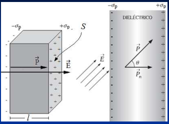

# Polarización



**Definimos al vector Polarización P de una sustancia como el momento dipolar
eléctrico por unidad de volumen.** Si n es el número de dipolos (moléculas
polarizadas) por unidad de volumen:

```math
\vec P=n\vec p
```

```math
[P]=(C\cdot L)/L^3=C/L^2
```

El momento dipolar eléctrico total de un paralelepido de volumen V = S l es :

```math
\left.\begin{aligned}
p_{total}&=PV=PSl=(PS)l\\
p&=ql=\sigma.S.l
\end{aligned}\right\}\Rightarrow PS:
```

Carga total de la superficie S

P es la densidad superficial de carga de polarización en la superficie del
material

Si consideramos al vector Polarización P de manera similar al campo eléctrico.
Visualizándolo mediante líneas de campo que van desde las cargas de polarización
negativas a las positivas, podemos escribir:

```math
PS=-Q_p\Rightarrow\vec P\cdot\overrightarrow{dS}=-dQ_p
```

```math
\oint\vec P\cdot\overrightarrow{dS}=-Q_p
```

El flujo del vector polarización a través de una superficie cerrada es igual a
la carga de polarización superficial con signo negativo.

## Procedencia y observaciones de transcripción

- Original:
  `2019/1er Parcial/2018 PF UT III - Capacidad. Prop electr de la Materia.pptx.pdf`,
  páginas 23 de 26, dos diapositivas por página salvo el cierre.
- SHA-256: `ac23675b753c3d9349b89600ea349edcbc8dfe56058b3c78a09e873777616145`.
- Fecha impresa: 28/03/2018. Ubicación canónica: material 2019. No consta autor
  en estas páginas.
- Herramientas: PyMuPDF4LLM y Poppler para extracción; cotejo visual de texto,
  expresiones, tablas y figuras. Medios conservados mediante recorte/render
  PyMuPDF, excepto las dos imágenes de carga por batería extraídas directamente
  del PDF.
- Cubre las diapositivas 45–46. Se conserva «paralelepido», p total frente a p,
  la afirmación sobre P como densidad superficial y el signo negativo de la
  carga. La integral cerrada del original es simple.
