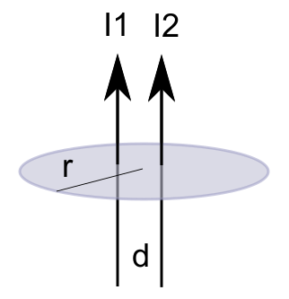
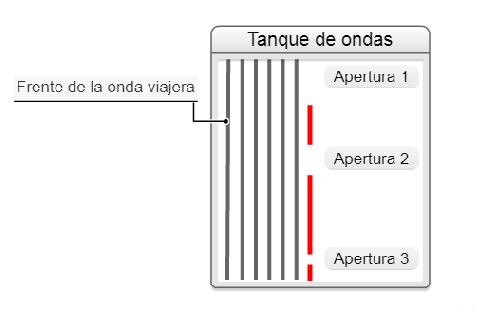
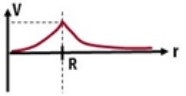
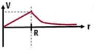
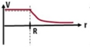
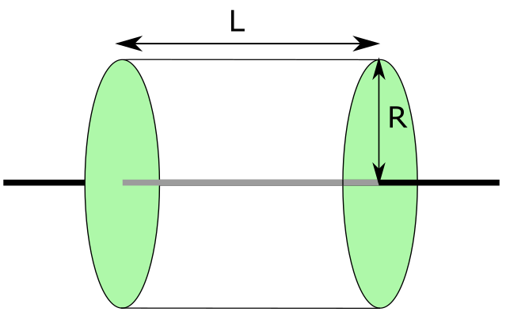
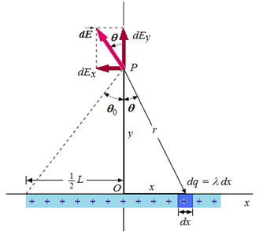
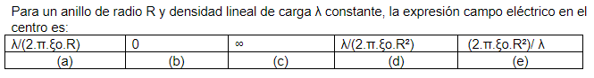

# Examen final de Física II — 10/12/2020, 17:00 horas

> Fuente: `2020/Modelo Finales/Examen final 10_12_2020.pdf`. SHA-256:
> `467d1310b934d25292edbcc0b239e7acac771579a31bb81a3787ac9cfc4d7464`. Diez
> páginas completas cotejadas con imágenes renderizadas y pdftotext -layout,
> además de la extracción PyMuPDF4LLM. Veinte preguntas, con todas sus opciones,
> figuras originales y ecuaciones gráficas transcritas a LaTeX. Se omiten
> calificaciones, puntajes, selecciones del intento y enlaces de navegación del
> campus. Las preguntas repetidas y el orden de las opciones se conservan; no se
> resuelven ni corrigen enunciados.

## Pregunta 1

El siguiente circuito RC indica, cuando se conecta la llave en la posición 1 se
produce el proceso de carga del capacitor. Al pasar luego la llave a la posición
2 se iniciará el proceso de descarga en forma gradual. Durante el proceso de
descarga ¿cuál de las siguientes afirmaciones es correcta?

Seleccione una:

a. No sabe / No responde

b. La diferencia de potencial entre sus armaduras aumentara y esto a su vez hará
que disminuya el flujo de corriente.

c. La diferencia de potencial entre sus armaduras disminuirá y esto a su vez
hará que aumente el flujo de corriente.

d. La diferencia de potencial entre sus armaduras aumentara y esto a su vez hará
que aumente el flujo de corriente.

e. La diferencia de potencial entre sus armaduras disminuirá y esto a su vez
hará que disminuya el flujo de corriente.

## Pregunta 2

Las unidades del vector polarización son:

Seleccione una:

a. $`\mathrm{C\ m}`$

b. No sabe/No contesta

c. $`\mathrm{C/m^3}`$

d. $`\mathrm{C/m^2}`$

e. Ninguna de las opciones es correcta.

## Pregunta 3

Sean dos hilos paralelos separados una distancia "d" y que llevan la misma
corriente I1 e I2. Si estos hilos atraviesan una superficie circular de radio r
y perpendicular a la misma, la ley de Ampere permite calcular:

Seleccione una:

a. Solamente el campo magnético en cualquier punto de la trayectoria cerrada

b. Solamente el flujo del campo magnético a través del área del círculo

c. No sabe / No responde

d. Solamente la circulación del campo magnético a través del perímetro de la
circunferencia

e. La circulación del campo magnético y el campo magnético en cualquier punto de
la trayectoria cerrada

## Pregunta 4

Las unidades del flujo del campo eléctrico son

Seleccione una:

- No sabe/ No responde
- $`\mathrm{lineas}\cdot\mathrm{m^2}`$
- $`\mathrm{N/coul}`$
- $`\mathrm{lineas/m^2}`$
- $`\mathrm N\cdot\mathrm{m^2}`$
- $`\mathrm{kg}\cdot\mathrm{m^3}/(\mathrm{seg^2}\cdot\mathrm{coul})`$
- $`\mathrm{coul}`$

## Pregunta 5

El multímetro cuando trabaja con magnitudes alternantes, mide

Seleccione una:

a. No sabe / No responde

b. Valores instantáneos

c. Valores eficaces

d. Valores máximos

e. Valores promedios

## Pregunta 6

El concepto de “dominios magnéticos” se asocia con los materiales:

Seleccione una:

a. Diamagnéticos.

b. Ferromagnéticos.

c. No sabe/No contesta.

d. Paramagnéticos.

e. Ninguna de las opciones.

## Pregunta 7

¿Cuál apertura causa un fenómeno de difracción?

Seleccione una:

a. No sabe/No contesta.

b. Apertura 1.

c. Apertura 3.

d. Ninguna de las opciones.

e. Apertura 2.

## Pregunta 8

Cuál de las siguientes figuras corresponde a la gráfica del potencial V en
función de la distancia r para una esfera conductora de radio R con carga
positiva?

Seleccione una:

a.

b.

c. No sabe / no responde

d.

e.

## Pregunta 9

Denominamos corriente continua en estado estacionario a aquella que cumple que:

Seleccione una:

a. Es constante en el tiempo.

b. No sabe / No responde

c. Varía uniformemente en el tiempo

d. Es variable en el tiempo.

e. No se disipa energía en ninguna parte del circuito.

## Pregunta 10

La figura muestra un **cilindro Gaussiano** de longitud L y radio R, siendo este
cilindro **atravesado por un hilo** con densidad de carga uniforme y longitud
infinita

Si aumenta la longitud L del cilindro Gaussiano, el flujo a través del mismo

Seleccione una:

- No sabe / No responde
- Disminuye
- Permanece constante
- Aumenta

## Pregunta 11

La figura muestra una barra uniformemente cargada de longitud L. Si la longitud
de la barra tiende a infinito, el campo en el punto P será igual a

| Rótulo original | Expresión |
| -- | -- |
| (a) | $`\infty`$ |
| (b) | $`0`$ |
| (c) | $`2\cdot k\cdot\lambda\cdot y`$ |
| (d) | $`2\cdot k\cdot\frac{\lambda}{y}`$ |
| (e) | $`2\cdot k\cdot\frac{y}{\lambda}`$ |

Seleccione una:

- Opción rotulada con (b) en el enunciado
- Opción rotulada con (a) en el enunciado
- Opción rotulada con (d) en el enunciado
- Opción rotulada con (e) en el enunciado
- No sabe/No responde
- Opción rotulada con (c) en el enunciado

## Pregunta 12

Sean dos condensadores semillenos con un dieléctrico tal como indica la figura.
El área de las placas y su separación son las mismas en ambos. ¿Cuál tiene mayor
capacidad?

Seleccione una:

a. Sus capacidades son iguales

b. No sabe/no contesta

c. El capacitor a

d. No se puede determinar

e. El capacitor b

## Pregunta 13

Cuál de las siguientes características NO corresponde a la ley de Coulomb?

Seleccione una:

a. Tiene la dirección de la línea que une las cargas

b. No sabe / No responde

c. Proporcional al producto de las cargas

d. Inversamente proporcional a la distancia de separación entre las cargas

e. Puede ser atractiva o repulsiva

## Pregunta 14

El Flujo Luminoso es:

Seleccione una:

a. La cantidad de luz emitida o radiada por una fuente de luz en todas las
direcciones.

b. No sabe/No contesta.

c. Una magnitud característica del objeto iluminado, que indica la cantidad de
luz que incide sobre su superficie, al ser iluminado por su fuente.

d. La cantidad de luz emitida en un segundo y en una determinada dirección.

e. La relación entre el flujo expresado en lúmenes de la fuente luminosa y la
potencia de la lámpara o fuente.

## Pregunta 15

Para un anillo de radio R y densidad lineal de carga λ constante, la expresión
campo eléctrico en el centro es:

| Rótulo original | Expresión |
| -- | -- |
| (a) | $`\lambda/(2\cdot\Pi\cdot\xi\mathrm{o}\cdot R)`$ |
| (b) | $`0`$ |
| (c) | $`\infty`$ |
| (d) | $`\lambda/(2\cdot\Pi\cdot\xi\mathrm{o}\cdot R^2)`$ |
| (e) | $`(2\cdot\Pi\cdot\xi\mathrm{o}\cdot R^2)/\lambda`$ |

Seleccione una:

- Opción (e)
- No sabe / No responde
- Opción (b)
- Opción (c)
- Opción (a)
- Opción (d)

> Nota de transcripción: la tabla utiliza las grafías «Π» y «ξo», conservadas
> sin sustituirlas por otra notación.

## Pregunta 16

Señalar la afirmación correcta:

Seleccione una:

a. La tensión a través de un inductor adelanta a la corriente en un cuarto de
periodo o 90º.

b. Se dice que un circuito RLC está en resonancia cuando $`XL=XC`$.

c. En la resonancia, la reactancia total es cero, por lo que el factor de
potencia también vale cero.

d. No sabe/No contesta.

e. La resistencia disipativa de un circuito de corriente alterna produce un
ángulo de desfase tal que $`\theta\lt0`$.

f. Ninguna de las opciones.

## Pregunta 17

Una partícula con carga positiva "q", se mueve con velocidad "v" en una
trayectoria circular de radio r alrededor de un alambre conductor como muestra
la figura. La expresión de la fuerza magnética es

Seleccione una:

a. $`\mu_0\cdot I\cdot v/(2\cdot\Pi)`$

b. No sabe / No responde

c. $`\mu_0\cdot I\cdot v/(2\cdot\Pi\cdot r)`$

d. Cero

e. Infinito

## Pregunta 18

El estatvoltio es una unidad de

Seleccione una:

a. Corriente eléctrica

b. Energía potencial eléctrica

c. No sabe / No contesta

d. Potencial eléctrico

## Pregunta 19

Sean dos condensadores semillenos con un dieléctrico tal como indica la figura.
El área de las placas y su separación son las mismas en ambos. ¿Cuál tiene mayor
capacidad?

Seleccione una:

a. No sabe/no contesta

b. El capacitor b

c. El capacitor a

d. No se puede determinar

e. Sus capacidades son iguales

## Pregunta 20

Los campos eléctricos inducidos.

Seleccione una:

a. Están asociados a cargas

b. Están asociados a variaciones temporales del flujo magnético.

c. No sabe/no contesta.

d. Ninguna respuesta es correcta.

e. Están asociados tanto a cargas como a variaciones temporales del flujo
magnético.
