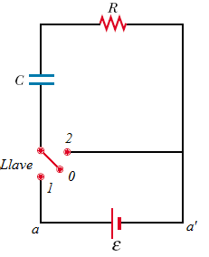
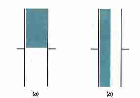
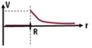

# Examen final de Física II — 17/12/2020, 17:00 horas

> Fuente:
> `2020/Modelo Finales/Examen final 17_12_2020 - 17_00 horas_ Revisión del intento.pdf`.
> SHA-256: `f642b1113819fe8ec70162e19871d641eeda54acd93dc3a3ff41fb1efca728a1`.
> PDF de una página larga con 16 preguntas. Extracción PyMuPDF4LLM, contraste
> con pdftotext -layout y cotejo visual de las 16 preguntas. Figuras extraídas
> del original; ecuaciones gráficas transcritas a LaTeX. Se omiten calificación,
> puntajes y marcas de respuesta del intento. Se conservan todas las opciones,
> sus erratas y su orden, sin resolverlas. La interfaz del campus y sus enlaces
> de navegación no forman parte del apunte.

UNIVERSIDAD TECNOLÓGICA NACIONAL

EXAMEN-FISICA 2

## Pregunta 1

Un haz paralelo de luz no polarizada en aire incide a un ángulo de 35.5°
(respecte a la horizontal) sobre una superficie plana de vidrio. El haz
reflejado está linealmente polarizado en su totalidad. El valor del índice de
refracción del medio es

Seleccione una:

a. 0.545

b. 0.355

c. 0.713

d. 1.402

e. No sabe / no responde

## Pregunta 2

Una onda electromagnética plana se propaga en el vacio, posee una frecuencia de
1kHz, la amplitud del campo del campo magnetico es de
$`3\times10^{-7}\,\mathrm T`$ y oscila en el eje de las +y, se sabe que el campo
eléctrico oscila en el eje de las +x, la expresion del vector de poynting en
unidades del sistema internacional es:

Seleccione una:

a.
$`\vec S(z,t)=0.239\left(\cos(2.1\cdot10^{-5}\cdot z-6.3\cdot10^3\cdot t)\right)^2\cdot\vec k`$

b.
$`\vec S(z,t)=21.5\cdot\left(\cos(2.1\cdot10^{-8}\cdot z-6.3\cdot t)\right)^2\cdot\vec k`$

c.
$`\vec S(z,t)=21.5\cdot\left(\cos(2.1\cdot10^{-8}\cdot z-6.3\cdot t)\right)\cdot\vec k`$

d. No sabe/ No responde

e.
$`\vec S(z,t)=21.5\cdot\left(\cos(2.1\cdot10^{-5}\cdot z-6.3\cdot10^3\cdot t)\right)^2\cdot\vec k`$

## Pregunta 3

El concepto de “dominios magnéticos” se asocia con los materiales:

Seleccione una:

a. Ninguna de las opciones.

b. Ferromagnéticos.

c. Paramagnéticos.

d. Diamagnéticos.

e. No sabe/No contesta.

## Pregunta 4

El siguiente circuito RC indica, cuando se conecta la llave en la posición 1 se
produce el proceso de carga del capacitor. Al pasar luego la llave a la posición
2 se iniciará el proceso de descarga en forma gradual. Durante el proceso de
descarga ¿cuál de las siguientes afirmaciones es correcta?

Seleccione una:

a. La diferencia de potencial entre sus armaduras disminuirá y esto a su vez
hará que aumente el flujo de corriente.

b. La diferencia de potencial entre sus armaduras disminuirá y esto a su vez
hará que disminuya el flujo de corriente.

c. La diferencia de potencial entre sus armaduras aumentara y esto a su vez hará
que aumente el flujo de corriente.

d. La diferencia de potencial entre sus armaduras aumentara y esto a su vez hará
que disminuya el flujo de corriente.

e. No sabe / No responde

## Pregunta 5

Una partícula con carga positiva "q", se mueve con velocidad "v" en una
trayectoria circular de radio r alrededor de un alambre conductor como muestra
la figura. La expresión de la fuerza magnética es

Seleccione una:

a. Cero

b. $`\mu_0\cdot I\cdot v/(2\cdot\Pi)`$

c. No sabe / No responde

d. $`\mu_0\cdot I\cdot v/(2\cdot\Pi\cdot r)`$

e. Infinito

## Pregunta 6

El Flujo Luminoso es:

Seleccione una:

a. La relación entre el flujo expresado en lúmenes de la fuente luminosa y la
potencia de la lámpara o fuente.

b. La cantidad de luz emitida o radiada por una fuente de luz en todas las
direcciones.

c. La cantidad de luz emitida en un segundo y en una determinada dirección.

d. No sabe/No contesta.

e. Una magnitud característica del objeto iluminado, que indica la cantidad de
luz que incide sobre su superficie, al ser iluminado por su fuente.

## Pregunta 7

Un neutrón se mueve en la dirección del eje "+x" con una velocidad de 30000 m/s
en una región donde existe un campo magnético de 2 T dirigido en la dirección
"+y". La fuerza magnética que actúa sobre el neutrón será:

Seleccione una:

a. 60000 Newton en la dirección del eje "+z"

b. 60000 Newton en la dirección del eje "-z"

c. $`9.6*10^{-15}`$ Newton en la dirección del eje "-z"

d. $`9.6*10^{-15}`$ Newton en la dirección del eje "+z"

e. No sabe / No responde

f. 0 Newton

## Pregunta 8

Sean dos condensadores semillenos con un dieléctrico tal como indica la figura.
El área de las placas y su separación son las mismas en ambos. ¿Cuál tiene mayor
capacidad?

Seleccione una:

a. El capacitor a

b. No se puede determinar

c. No sabe/no contesta

d. El capacitor b

e. Sus capacidades son iguales

## Pregunta 9

La figura muestra una barra uniformemente cargada de longitud L. Si la longitud
de la barra tiende a infinito, el campo en el punto P será igual a

| Rótulo original | Expresión |
| -- | -- |
| (a) | $`\infty`$ |
| (b) | $`0`$ |
| (c) | $`2\cdot k\cdot\lambda\cdot y`$ |
| (d) | $`2\cdot k\cdot\frac{\lambda}{y}`$ |
| (e) | $`2\cdot k\cdot\frac{y}{\lambda}`$ |

Seleccione una:

- Opción rotulada con (e) en el enunciado

- Opción rotulada con (d) en el enunciado

- Opción rotulada con (a) en el enunciado

- No sabe/No responde

- Opción rotulada con (c) en el enunciado

- Opción rotulada con (b) en el enunciado

## Pregunta 10

En un cierto proceso se suministran a un sistema 50000 cal y simultáneamente el
sistema se expande venciendo la presión exterior constante
$`7{,}2\ \mathrm{Kgr/m^2}`$ La energía interna del sistema es la misma al
comienzo que al final del proceso. El incremento de volumen del sistema será.

Seleccione una:

a. $`2965\ \mathrm{cm^3}`$

b. 29.65 L

c. $`2965\ \mathrm{m^3}`$

d. No sabe / no responde

## Pregunta 11

Señalar la afirmación correcta:

Seleccione una:

a. No sabe/No contesta.

b. Ninguna de las opciones.

c. La tensión a través de un inductor adelanta a la corriente en un cuarto de
periodo o 90º.

d. Se dice que un circuito RLC está en resonancia cuando $`XL=XC`$.

e. La resistencia disipativa de un circuito de corriente alterna produce un
ángulo de desfase tal que $`\theta\lt0`$.

f. En la resonancia, la reactancia total es cero, por lo que el factor de
potencia también vale cero.

## Pregunta 12

¿Cuál de las siguientes afirmaciones sobre autoinducción es correcta?

Seleccione una:

a. La autoinducción ocurre sólo cuando una corriente directa fluye por el
circuito.

b. La autoinducción ocurre cuando por un circuito fluye una corriente directa o
una corriente alterna, siempre y cuando la corriente varíe.

c. La autoinducción ocurre sólo cuando una corriente alterna fluye por el
circuito.

d. No sabe/no contesta.

e. La autoinducción ocurre cuando por un circuito fluye una corriente directa o
una corriente alterna.

## Pregunta 13

¿Cuál apertura causa un fenómeno de difracción?

Seleccione una:

a. No sabe/No contesta.

b. Apertura 1.

c. Ninguna de las opciones.

d. Apertura 3.

e. Apertura 2.

## Pregunta 14

Cuál de las siguientes figuras corresponde a la gráfica del potencial V en
función de la distancia r para una esfera conductora de radio R con carga
positiva?

Seleccione una:

a.

b.

c. No sabe / no responde

d.

e.

## Pregunta 15

Luz solar incide perpendicularmente sobre una doble rendija de 3 mm de ancho
separadas entre si una distancia de 12 mm. Si se coloca una pantalla a 1 m de
distancia y considerando que a la misma solo llega la luz proveniente de las dos
rendijas, se podrá observar sobre esta pantalla:

Seleccione una:

a. Un patrón de interferencia superpuesto al de difracción

b. Un patrón de difracción

c. No sabe / No responde

d. Dos puntos brillantes

e. Un patrón de interferencia

## Pregunta 16

¿Cómo se define el calor latente?

Seleccione una:

a. Cantidad de calor necesaria para aumentar en un grado la temperatura de un
determinado cuerpo por unidad de masa manteniendo el volumen constante.

b. Cantidad de calor necesaria para aumentar en un grado la temperatura de un
determinado cuerpo por unidad de masa manteniendo la presión constante.

c. No sabe ( no responde

d. Cantidad de calor necesaria para aumentar en un grado la temperatura de un
determinado cuerpo manteniendo el volumen constante.

e. Cantidad de calor necesaria para aumentar en un grado la temperatura de un
determinado cuerpo manteniendo la presión constante.

f. Es la energía que debe ser transferida, en forma de calor por unidad de masa
a una sustancia mantenida a presión y temperatura constante para que ocurra un
cambio de fase.
