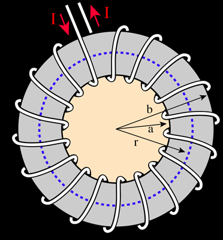
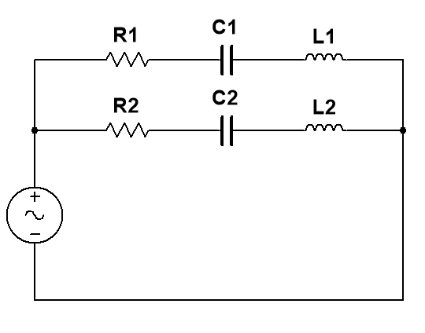

# Segundo parcial de Sistemas A — junio de 2020, variante 1

> Fuente: `2020/Parciales/PARCIAL 2 FISICA 2020.pdf`. SHA-256:
> `e236a8b0f8b23c292ba97500fd4c252a25d021bd4adef0358ed816e845675b09`. Páginas
> 9–16 del PDF compilado; 14 preguntas completas. Cabecera de impresión
> 15/6/2020; comienzo del intento 13/06/2020. «Variante 1» identifica
> editorialmente el primer bloque de Sistemas A. PyMuPDF4LLM contrastado con
> pdftotext -layout y cotejo visual de las ocho páginas. Cuatro figuras
> originales; se conservan enunciados, orden, notación y todas las opciones sin
> resolver ni corregir. Se omiten calificación, puntajes, selecciones e
> identificadores del intento y navegación del campus.

2DO PARCIAL ISI A

## Pregunta 1

La figura muestra un toroide de "N" vueltas de radio interno "a" y radio externo
"b" y por el que circula una corriente "I". El flujo del campo magnético a
través del área circular de radio "r" es

Seleccione una:

a. $`\mu_0\cdot N\cdot I\cdot r/(a+b)`$

b. Cero

c. $`\mu_0\cdot N\cdot I\cdot r/2`$

d. $`\mu_0\cdot N\cdot I\cdot r^2/(a+b)`$

e. $`\mu_0\cdot N\cdot I\cdot r^2/2`$

f. No sabe / No responde

## Pregunta 2

Los campos eléctricos inducidos.

Seleccione una:

a. No sabe/no contesta.

b. Están asociados tanto a cargas como a variaciones temporales del flujo
magnético.

c. Están asociados a cargas

d. Ninguna respuesta es correcta.

e. Están asociados a variaciones temporales del flujo magnético.

## Pregunta 3

El concepto de “dominios magnéticos” se asocia con los materiales:

Seleccione una:

a. No sabe/No contesta.

b. Paramagnéticos.

c. Diamagnéticos.

d. Ferromagnéticos.

e. Ninguna de las opciones.

## Pregunta 4

El valor eficaz de una función es matemáticamente hablando

Seleccione una:

a. No sabe / No responde

b. El promedio de los valores máximos de la función

c. El promedio del cuadrado de la función

d. El promedio de la función

e. El promedio de la raíz cuadrada de la función elevada al cuadrado

## Pregunta 5

Una partícula con carga positiva "q", se mueve con velocidad "v" en una
trayectoria circular de radio r alrededor de un alambre conductor como muestra
la figura. La expresión de la fuerza magnética es

Seleccione una:

a. $`\mu_0\cdot I\cdot v/(2\cdot\Pi\cdot r)`$

b. No sabe / No responde

c. Cero

d. Infinito

e. $`\mu_0\cdot I\cdot v/(2\cdot\Pi)`$

## Pregunta 6

En el Sistema Internacional la unidad de flujo magnético es

Seleccione una:

a. Gauss

b. Wéber

c. Tesla

d. Ninguna de las opciones

e. No sabe/no contesta.

## Pregunta 7

La magnetización M de un material diamagnético:

Seleccione una:

a. No sabe/No contesta.

b. Es positiva y mayor que $`\mu_0H`$.

c. Es nula.

d. Ninguna de las opciones.

e. Es positiva y menor que $`\mu_0H`$.

f. Es negativa.

## Pregunta 8

Señalar la afirmación correcta:

Seleccione una:

a. En la resonancia, la reactancia total es cero, por lo que el factor de
potencia también vale cero.

b. Se dice que un circuito RLC está en resonancia cuando $`XL=XC`$.

c. No sabe/No contesta.

d. La resistencia disipativa de un circuito de corriente alterna produce un
ángulo de desfase tal que $`\theta\lt0`$.

e. La tensión a través de un inductor adelanta a la corriente en un cuarto de
periodo o 90º.

f. Ninguna de las opciones.

## Pregunta 9

Una bobina consta de 200 vueltas de alambre y tiene una resistencia total de 2
Ω. Cada vuelta es un cuadrado de 18 cm de lado y se activa un campo magnético
uniforme perpendicular al plano de la bobina. Si el campo cambia linealmente de
0 a 0,5 Tesla en 0,8 s. ¿Cual es la magnitud de la fem inducida en la bobina
mientras está cambiando el campo?

Seleccione una:

a. $`\varepsilon=3{,}05\,\mathrm V`$

b. $`\varepsilon=5{,}05\,\mathrm V`$

c. $`\varepsilon=-4{,}05\,\mathrm V`$

d. NO SABE/NO CONTESTA

e. $`\varepsilon=6{,}05\,\mathrm V`$

## Pregunta 10

Calcule el campo magnético en el aire de un alambre infinito a un radio de 5 cm
por el que circula una corriente de 10 amp.

Seleccione una:

a. $`B=4000\times10^{-7}\ \text{Tesla}`$

b. $`B=400\times10^{-7}\ \text{Tesla}`$

c. $`B=3000\times10^{-7}\ \text{Tesla}`$

d. No sabe/ no responde.

## Pregunta 11

En el circuito de la figura donde la fem $`V(t)=311\cdot\cos(2\pi f t)`$ con
$`f=50\,\mathrm{Hz}`$, $`R1=50\ \mathrm{ohm}`$, $`R2=25\ \mathrm{ohm}`$,
$`C1=300\,\mu\mathrm F`$, $`C2=600\,\mu\mathrm F`$, $`L1=0{,}1\,\mathrm H`$,
$`L2=0{,}05\,\mathrm H`$, el valor de la corriente que circula por la rama de
R2-C2-L2 es:

Seleccione una:

a. $`i(t)=3{,}83\,\mathrm A\cdot\cos(314\cdot t-22{,}57^\circ)`$

b. $`i(t)=11{,}49\,\mathrm A\cdot\cos(314\cdot t-22{,}57^\circ)`$

c. No sabe / No responde

d. $`i(t)=17{,}23\,\mathrm A\cdot\cos(314\cdot t-22{,}57^\circ)`$

e. $`i(t)=5{,}74\,\mathrm A\cdot\cos(314\cdot t-22{,}57^\circ)`$

## Pregunta 12

En el circuito de la figura donde la fem $`V(t)=311\cdot\cos(2\pi f t)`$ con
$`f=50\,\mathrm{Hz}`$, $`R1=50\ \mathrm{ohm}`$, $`R2=25\ \mathrm{ohm}`$,
$`C1=300\,\mu\mathrm F`$, $`C2=600\,\mu\mathrm F`$, $`L1=0{,}1\,\mathrm H`$,
$`L2=0{,}05\,\mathrm H`$, el valor de la corriente que entrega la fuente es:

Seleccione una:

a. $`i(t)=3{,}83\,\mathrm A\cdot\cos(314\cdot t-22{,}57^\circ)`$

b. $`i(t)=5{,}74\,\mathrm A\cdot\cos(314\cdot t-22{,}57^\circ)`$

c. $`i(t)=17{,}23\,\mathrm A\cdot\cos(314\cdot t-22{,}57^\circ)`$

d. No sabe / No responde

e. $`i(t)=11{,}49\,\mathrm A\cdot\cos(314\cdot t-22{,}57^\circ)`$

## Pregunta 13

Un anillo de Rowland, hecho de hierro, cuya longitud de la circunferencia media
es de 40 cm y cuya sección es de 20 cm2 está enrollado uniformemente con 200
espiras de hilo conductor. Las medidas efectuadas demuestran que cuando la
corriente en el enrollamiento es de 0,50A el flujo en el anillo es de
$`2\cdot10^{-3}\,\mathrm{Wb}`$. La susceptibilidad magnética es:

Seleccione una:

a. 3,182

b. 3182

c. 31,82

d. 318,2

e. No sabe / No responde

## Pregunta 14

Una bobina rectangular de 30 espiras y lados de 5 cm y 7 cm, se encuentra en una
región del espacio donde hay un campo magnético $`B1=0{,}3\,\mathrm T`$, con
dirección perpendicular al eje de la bobina. Si en un período de tiempo igual a
$`\Delta t=1{,}5\,\mathrm s`$, se acerca la bobina hasta una nueva posición en
donde el campo vale $`B2=0{,}8\,\mathrm T`$, calcular el valor de la fem
inducida en al bobina.

Seleccione una:

a. $`\varepsilon=-0{,}035\,\mathrm V`$

b. No sabe/No responde

c. $`\varepsilon=-3{,}5\,\mathrm V`$

d. $`\varepsilon=12\,\mathrm V`$

e. $`\varepsilon=3{,}5\,\mathrm V`$
