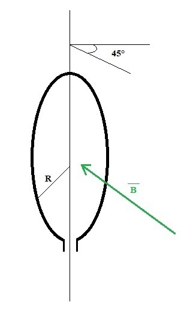

# Segundo parcial de Sistemas A — junio de 2020, variante 2

> Fuente: `2020/Parciales/PARCIAL 2 FISICA 2020.pdf`. SHA-256:
> `e236a8b0f8b23c292ba97500fd4c252a25d021bd4adef0358ed816e845675b09`. Páginas
> 25–31 del PDF compilado; 14 preguntas completas. Cabecera de impresión
> 17/6/2020; comienzo del intento 13/06/2020. La numeración de variante es
> editorial y sigue los bloques de cada comisión. PyMuPDF4LLM contrastado con
> pdftotext -layout y cotejo visual de todas las páginas del bloque, incluidas
> las páginas de solo navegación. Figuras originales; ecuaciones transcritas y
> todas las opciones conservadas, sin resolver ni corregir. Se omiten
> calificación, puntajes, selecciones, identificadores del intento y navegación
> del campus.

2do Parcial ISI A

## Pregunta 1

Las unidades de $`\mu_0`$ son

Seleccione una:

a. Ninguna es correcta

b. $`\mathrm T\cdot\mathrm A/\mathrm m`$

c. $`\mathrm{kg}\cdot\mathrm m/(\mathrm{s^2}\cdot\mathrm{A^2})`$

d. $`\mathrm T/(\mathrm A,\mathrm m)`$

e. No sabe / no responde

## Pregunta 2

El valor e caz de una función es matemáticamente hablando

Seleccione una:

a. El promedio de los valores máximos de la función

b. No sabe / No responde

c. El promedio del cuadrado de la función

d. El promedio de la raíz cuadrada de la función elevada al cuadrado

e. El promedio de la función

## Pregunta 3

Un alambre largo conduce una corriente, i, como muestra la figura. Un bucle
cuadrado se mueve en el mismo plano que el alambre, según se indica. ¿En qué
casos el bucle tiene una corriente inducida?

Seleccione una:

a. Casos 1 y 2.

b. Todos los bucles tienen una corriente inducida.

c. No sabe/no contesta.

d. Casos 1 y 3.

e. Casos 2 y 3.

f. Ninguno de los bucles tiene una corriente inducida.

## Pregunta 4

¿Cuál de las siguientes afirmaciones sobre autoinducción es correcta?

Seleccione una:

a. La autoinducción ocurre cuando por un circuito fluye una corriente directa o
una corriente alterna, siempre y cuando la corriente varíe.

b. La autoinducción ocurre sólo cuando una corriente alterna fluye por el
circuito.

c. La autoinducción ocurre cuando por un circuito fluye una corriente directa o
una corriente alterna.

d. La autoinducción ocurre sólo cuando una corriente directa fluye por el
circuito.

e. No sabe/no contesta.

## Pregunta 5

La magnetización M en el Sistema Internacional se mide en:

Seleccione una:

- A/m.
- Ninguna de las opciones.
- A.m.
- No sabe/No contesta.
- $`\mathrm{A/m^2}`$.

## Pregunta 6

En el Sistema Internacional la unidad de flujo magnético es

Seleccione una:

a. No sabe/no contesta.

b. Ninguna de las opciones

c. Tesla

d. Wéber

e. Gauss

## Pregunta 7

Para el caso de la magnetización M, indique cual de las siguientes afirmaciones
es correcta:

Seleccione una:

a. La magnetización M que aparece en los materiales es también causada por la
permeabilidad magnética del material.

b. La magnetización M que aparece en los materiales es también consecuencia de
cargas eléctricas que se encuentran en reposo en el material.

c. No sabe/No contesta.

d. La magnetización M que aparece en los materiales es también consecuencia del
movimiento de cargas magnéticas presentes en el material.

e. La magnetización M que aparece en los materiales es también causada por la
excitación magnética H.

f. Ninguna de las opciones.

## Pregunta 8

Señalar la a rmación correcta:

Seleccione una:

a. No sabe/No contesta.

b. En la resonancia, la reactancia total es cero, por lo que el factor de
potencia también vale cero.

c. La resistencia disipativa de un circuito de corriente alterna produce un
ángulo de desfase tal que $`\theta\lt0`$.

d. La tensión a través de un inductor adelanta a la corriente en un cuarto de
periodo o 90º.

e. Se dice que un circuito RLC está en resonancia cuando $`XL=XC`$.

f. Ninguna de las opciones.

## Pregunta 9

Una bobina consta de 200 vueltas de alambre y tiene una resistencia total de 2
Ω. Cada vuelta es un cuadrado de 18 cm de lado y se activa un campo magnético
uniforme perpendicular al plano de la bobina. Si el campo cambia linealmente de
0 a 0,5 Tesla en 0,8 s. ¿Cual es la magnitud de la fem inducida en la bobina
mientras está cambiando el campo?

Seleccione una:

a. $`\varepsilon=5{,}05\,\mathrm V`$

b. $`\varepsilon=3{,}05\,\mathrm V`$

c. NO SABE/NO CONTESTA

d. $`\varepsilon=-4{,}05\,\mathrm V`$

e. $`\varepsilon=6{,}05\,\mathrm V`$

## Pregunta 10

Calcule el campo magnético en el aire de un alambre in nito a un radio de 5 cm
por el que circula una corriente de 10 amp.

Seleccione una:

a. $`B=4000\times10^{-7}\ \text{Tesla}`$

b. No sabe/ no responde.

c. $`B=3000\times10^{-7}\ \text{Tesla}`$

d. $`B=400\times10^{-7}\ \text{Tesla}`$

## Pregunta 11

Se tiene una bobina circular de radio $`R=15\,\mathrm{cm}`$ . El plano de esta
bobina es perpendicular a un campo magnético $`B=0{,}5\,\mathrm T`$. Cuando esta
bobina realiza una rotación de 45° sobre su eje en 0,75 s, produce una
diferencia de potencial igual a $`\varepsilon=3{,}926\,\mathrm V`$. Determinar
el número de espiras de la bobina.

Seleccione una:

a. $`N=150\ \text{espiras}`$

b. No sabe/No responde

c. $`N=1250\ \text{espiras}`$

d. $`N=750\ \text{espiras}`$

e. $`N=250\ \text{espiras}`$

## Pregunta 12

Un anillo de Rowland, hecho de hierro, cuya longitud de la circunferencia media
es de 40 cm y cuya sección es de 20 cm2 está enrollado uniformemente con 200
espiras de hilo conductor. Las medidas efectuadas demuestran que cuando la
corriente en el enrollamiento es de 0,50A el flujo en el anillo es de
$`2\cdot10^{-3}\,\mathrm{Wb}`$. La susceptibilidad magnética es:

Seleccione una:

a. No sabe / No responde

b. 318,2

c. 31,82

d. 3,182

e. 3182

## Pregunta 13

Un circuito RLC en serie , con $`R=350\,\Omega`$ , $`L=0{,}35\ \mathrm{Hy}`$ y
$`C=2\ \text{micro faradio}`$ ; se conectan a una fuente de alimentación cuya
tensión eficáz es de 100 V y $`\omega=1000\ \mathrm{rad/seg}`$. Calcular : a) La
impedancia del circuito b) La potencia activa y reactiva

c) La frecuencia de resonancia

Seleccione una:

a. No sabe, no contesta.

b.
$`Z=2480\,\Omega,\quad P=33{,}138\,\mathrm W,\quad Q=-40{,}345\,\mathrm{VA},\quad f=20{,}227\,\mathrm{s^{-1}}`$

c.
$`Z=380\,\Omega,\quad P=24{,}138\,\mathrm W,\quad Q=-10{,}345\,\mathrm{VA},\quad f=190{,}227\,\mathrm{s^{-1}}`$

d.
$`Z=3480\,\Omega,\quad P=29{,}138\,\mathrm W,\quad Q=200{,}345\,\mathrm{VA},\quad f=10{,}227\,\mathrm{s^{-1}}`$

## Pregunta 14

En el circuito de la figura donde la fem $`V(t)=311\cdot\cos(2\pi f t)`$ con
$`f=50\,\mathrm{Hz}`$, $`R1=50\ \mathrm{ohm}`$, $`R2=25\ \mathrm{ohm}`$,
$`C1=300\,\mu\mathrm F`$, $`C2=600\,\mu\mathrm F`$, $`L1=0{,}1\,\mathrm H`$,
$`L2=0{,}05\,\mathrm H`$, el valor de la corriente que entrega la fuente es:

Seleccione una:

a. $`i(t)=11{,}49\,\mathrm A\cdot\cos(314\cdot t-22{,}57^\circ)`$

b. $`i(t)=5{,}74\,\mathrm A\cdot\cos(314\cdot t-22{,}57^\circ)`$

c. $`i(t)=17{,}23\,\mathrm A\cdot\cos(314\cdot t-22{,}57^\circ)`$

d. No sabe / No responde

e. $`i(t)=3{,}83\,\mathrm A\cdot\cos(314\cdot t-22{,}57^\circ)`$
