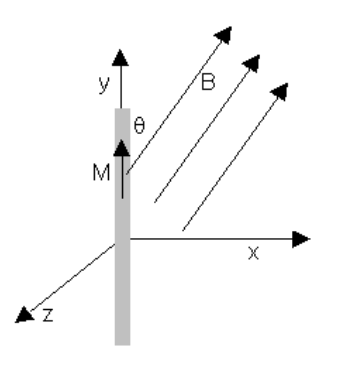
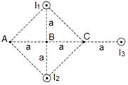

# Segundo parcial de Sistemas B — junio de 2020, variante 1

> Fuente: `2020/Parciales/PARCIAL 2 FISICA 2020.pdf`. SHA-256:
> `e236a8b0f8b23c292ba97500fd4c252a25d021bd4adef0358ed816e845675b09`. Páginas
> 1–8 del PDF compilado; 14 preguntas completas. La cabecera de impresión indica
> 17/6/2020 y el intento comenzó el 13/06/2020. «Variante 1» distingue
> editorialmente el primer bloque de Sistemas B del compilado, conservando su
> orden de preguntas y opciones. PyMuPDF4LLM contrastado con pdftotext -layout y
> cotejo visual de las ocho páginas. Figuras originales extraídas y seis
> opciones gráficas transcritas a LaTeX. Se omiten calificación, puntajes,
> marcas de respuesta e identificadores del intento y navegación del campus. No
> se resuelven ni corrigen los ejercicios.

2do Parcial ISI B

## Pregunta 1

La magnetización M de un material diamagnético:

Seleccione una:

a. Es positiva y menor que $`\mu_0H`$.

b. Ninguna de las opciones.

c. Es nula.

d. Es positiva y mayor que $`\mu_0H`$.

e. Es negativa.

f. No sabe/No contesta.

## Pregunta 2

Un alambre largo conduce una corriente, i, como muestra la figura. Un bucle
cuadrado se mueve en el mismo plano que el alambre, según se indica. ¿En qué
casos el bucle tiene una corriente inducida?

Seleccione una:

a. Casos 1 y 3.

b. Ninguno de los bucles tiene una corriente inducida.

c. No sabe/no contesta.

d. Casos 1 y 2.

e. Casos 2 y 3.

f. Todos los bucles tienen una corriente inducida.

## Pregunta 3

Las unidades de $`\mu_0`$ son

Seleccione una:

a. Ninguna es correcta

b. No sabe / no responde

c. $`\mathrm T/(\mathrm A,\mathrm m)`$

d. $`\mathrm{kg}\cdot\mathrm m/(\mathrm{s^2}\cdot\mathrm{A^2})`$

e. $`\mathrm T\cdot\mathrm A/\mathrm m`$

## Pregunta 4

La magnetización M en el Sistema Internacional se mide en:

Seleccione una:

- A/m.
- No sabe/No contesta.
- $`\mathrm{A/m^2}`$.
- Ninguna de las opciones.
- A.m.

## Pregunta 5

Los campos eléctricos inducidos.

Seleccione una:

a. No sabe/no contesta.

b. Están asociados a variaciones temporales del flujo magnético.

c. Están asociados tanto a cargas como a variaciones temporales del flujo
magnético.

d. Están asociados a cargas

e. Ninguna respuesta es correcta.

## Pregunta 6

Para el caso de la magnetización M, indique cual de las siguientes afirmaciones
es correcta:

Seleccione una:

a. La magnetización M que aparece en los materiales es también causada por la
permeabilidad magnética del material.

b. La magnetización M que aparece en los materiales es también causada por la
excitación magnética H.

c. La magnetización M que aparece en los materiales es también consecuencia de
cargas eléctricas que se encuentran en reposo en el material.

d. Ninguna de las opciones.

e. No sabe/No contesta.

f. La magnetización M que aparece en los materiales es también consecuencia del
movimiento de cargas magnéticas presentes en el material.

## Pregunta 7

En un circuito R-L-C serie conectado a una fuente, ¿puede el voltaje sobre
alguno de los elementos ser mayor que el voltaje de la fuente?

Seleccione una:

a. No sabe/no contesta

b. Si, sobre la resistencia

c. Si, sobre la inductancia y la capacidad

d. Si, sobre cualquiera de ellos

e. No, el voltaje sobre los elementos no puede ser mayor que el voltaje de la
fuente

## Pregunta 8

¿Cuál de las siguientes afirmaciones sobre autoinducción es correcta?

Seleccione una:

a. No sabe/no contesta.

b. La autoinducción ocurre cuando por un circuito fluye una corriente directa o
una corriente alterna, siempre y cuando la corriente varíe.

c. La autoinducción ocurre sólo cuando una corriente directa fluye por el
circuito.

d. La autoinducción ocurre cuando por un circuito fluye una corriente directa o
una corriente alterna.

e. La autoinducción ocurre sólo cuando una corriente alterna fluye por el
circuito.

## Pregunta 9

Una varilla imantada de longitud 100 cm, sección 5cm2 y magnetización
$`M=100\,\mathrm{A/m}`$ se coloca en una región donde existe un campo
$`B=1\,\mathrm T`$ con el que forma un ángulo de 30º como muestra la figura, el
par sobre la varilla es:

Seleccione una:

a. $`-0{,}0025\,\mathrm{N.m}`$ versor j

b. $`-0{,}025\,\mathrm{N.m}`$ versor k

c. No sabe / No responde

d. $`-0{,}0025\,\mathrm{N.m}`$ versor k

e. $`-0{,}025\,\mathrm{N.m}`$ versor j

## Pregunta 10

En el circuito de la figura donde la fem $`V(t)=311\cdot\cos(2\pi f t)`$ con
$`f=50\,\mathrm{Hz}`$, $`R1=50\ \mathrm{ohm}`$, $`R2=25\ \mathrm{ohm}`$,
$`C1=300\,\mu\mathrm F`$, $`C2=600\,\mu\mathrm F`$, $`L1=0{,}1\,\mathrm H`$,
$`L2=0{,}05\,\mathrm H`$, el valor de la corriente que circula por la rama de
R2-C2-L2 es:

Seleccione una:

a. $`i(t)=17{,}23\,\mathrm A\cdot\cos(314\cdot t-22{,}57^\circ)`$

b. $`i(t)=5{,}74\,\mathrm A\cdot\cos(314\cdot t-22{,}57^\circ)`$

c. $`i(t)=3{,}83\,\mathrm A\cdot\cos(314\cdot t-22{,}57^\circ)`$

d. No sabe / No responde

e. $`i(t)=11{,}49\,\mathrm A\cdot\cos(314\cdot t-22{,}57^\circ)`$

## Pregunta 11

Un circuito RLC en serie , con $`R=350\,\Omega`$ , $`L=0{,}35\ \mathrm{Hy}`$ y
$`C=2\ \text{micro faradio}`$ ; se conectan a una fuente de alimentación cuya
tensión eficáz es de 100 V y $`\omega=1000\ \mathrm{rad/seg}`$. Calcular : a) La
impedancia del circuito

b) La potencia activa y reactiva

c) La frecuencia de resonancia

Seleccione una:

a. No sabe, no contesta.

b.
$`Z=3480\,\Omega,\quad P=29{,}138\,\mathrm W,\quad Q=200{,}345\,\mathrm{VA},\quad f=10{,}227\,\mathrm{s^{-1}}`$

c.
$`Z=380\,\Omega,\quad P=24{,}138\,\mathrm W,\quad Q=-10{,}345\,\mathrm{VA},\quad f=190{,}227\,\mathrm{s^{-1}}`$

d.
$`Z=2480\,\Omega,\quad P=33{,}138\,\mathrm W,\quad Q=-40{,}345\,\mathrm{VA},\quad f=20{,}227\,\mathrm{s^{-1}}`$

## Pregunta 12

Un anillo de Rowland, hecho de hierro, cuya longitud de la circunferencia media
es de 40 cm y cuya sección es de 20 cm2 está enrollado uniformemente con 200
espiras de hilo conductor. Las medidas efectuadas demuestran que cuando la
corriente en el enrollamiento es de 0,50A el flujo en el anillo es de
$`2\cdot10^{-3}\,\mathrm{Wb}`$. La susceptibilidad magnética es:

Seleccione una:

a. 31,82

b. 3182

c. 3,182

d. 318,2

e. No sabe / No responde

## Pregunta 13

Tres largos conductores paralelos llevan corrientes de $`I=2\,\mathrm A`$ como
muestra la figura, con las corrientes saliendo de la página. Si
$`a=1\,\mathrm{cm}`$,

a) determinar la magnitud y dirección del campo magnético en el punto A

b) calcular la fuerza por unidad de longitud ejercida por $`I_1`$ sobre el
conductor $`I_2`$

Seleccione una:

a. No sabe,no contesta.

b. a) $`Ba=5{,}37\cdot10^{-5}\,\mathrm T`$ arriba de la hoja; b)
$`F/L=3{,}2\,\mathrm{N/m}`$ atracción

c. a) $`Ba=5{,}37\cdot10^{-5}\,\mathrm T`$ arriba de la hoja; b)
$`F/L=3{,}2\,\mathrm{N/m}`$ atracción

d. a) $`Ba=5{,}37\cdot10^{-5}\,\mathrm T`$ hacia abajo de la hoja; b)
$`F/l=2{,}5\,\mathrm{N/m}`$ atracción

> Nota de transcripción: las opciones b y c repiten la misma respuesta en el
> original; se mantienen ambas. La opción d usa «F/l».

## Pregunta 14

Una bobina consta de 200 vueltas de alambre y tiene una resistencia total de 2
Ω. Cada vuelta es un cuadrado de 18 cm de lado y se activa un campo magnético
uniforme perpendicular al plano de la bobina. Si el campo cambia linealmente de
0 a 0,5 Tesla en 0,8 s. ¿Cual es la magnitud de la fem inducida en la bobina
mientras está cambiando el campo?

Seleccione una:

a. $`\varepsilon=5{,}05\,\mathrm V`$

b. $`\varepsilon=3{,}05\,\mathrm V`$

c. $`\varepsilon=6{,}05\,\mathrm V`$

d. $`\varepsilon=-4{,}05\,\mathrm V`$

e. NO SABE/NO CONTESTA
