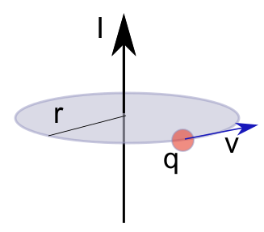
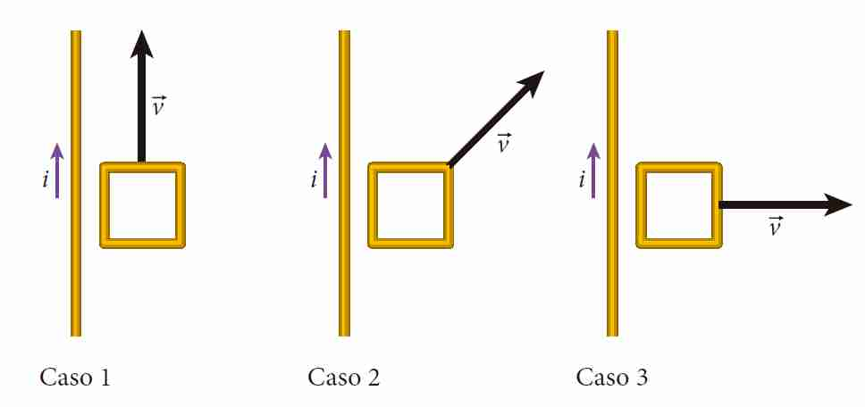
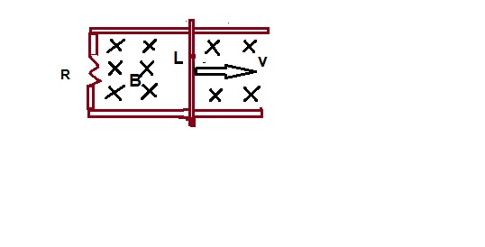

# Segundo parcial de Sistemas B — junio de 2020, variante 2

> Fuente: `2020/Parciales/PARCIAL 2 FISICA 2020.pdf`. SHA-256:
> `e236a8b0f8b23c292ba97500fd4c252a25d021bd4adef0358ed816e845675b09`. Páginas
> 17–24 del PDF compilado; 14 preguntas completas. Cabecera de impresión
> 16/6/2020; comienzo del intento 13/06/2020. La numeración de variante es
> editorial y sigue los bloques de cada comisión. PyMuPDF4LLM contrastado con
> pdftotext -layout y cotejo visual de todas las páginas del bloque, incluidas
> las páginas de solo navegación. Figuras originales; ecuaciones transcritas y
> todas las opciones conservadas, sin resolver ni corregir. Se omiten
> calificación, puntajes, selecciones, identificadores del intento y navegación
> del campus.

2do Parcial ISI B

## Pregunta 1

La magnetización M en el Sistema Internacional se mide en:

Seleccione una:

- A.m.
- $`\mathrm{A/m^2}`$.
- A/m.
- Ninguna de las opciones.
- No sabe/No contesta.

## Pregunta 2

Los campos eléctricos inducidos.

Seleccione una:

a. Están asociados a variaciones temporales del flujo magnético.

b. Están asociados a cargas

c. Ninguna respuesta es correcta.

d. No sabe/no contesta.

e. Están asociados tanto a cargas como a variaciones temporales del flujo
magnético.

## Pregunta 3

Las unidades de $`\mu_0`$ son

Seleccione una:

a. $`\mathrm T/(\mathrm A,\mathrm m)`$

b. $`\mathrm{kg}\cdot\mathrm m/(\mathrm{s^2}\cdot\mathrm{A^2})`$

c. $`\mathrm T\cdot\mathrm A/\mathrm m`$

d. Ninguna es correcta

e. No sabe / no responde

## Pregunta 4

Una partícula con carga positiva "q", se mueve con velocidad "v" en una
trayectoria circular de radio r alrededor de un alambre conductor como muestra
la figura. La expresión de la fuerza magnética es

Seleccione una:

a. $`\mu_0\cdot I\cdot v/(2\cdot\Pi\cdot r)`$

b. No sabe / No responde

c. Cero

d. $`\mu_0\cdot I\cdot v/(2\cdot\Pi)`$

e. Infinito

## Pregunta 5

Sean dos hilos paralelos separados una distancia "d" y que llevan la misma
corriente I1 e I2. Si estos hilos atraviesan una superficie circular de radio r
y perpendicular a la misma, la ley de Ampere permite calcular:

Seleccione una:

a. La circulación del campo magnético y el campo magnético en cualquier punto de
la trayectoria cerrada

b. Solamente el campo magnético en cualquier punto de la trayectoria cerrada

c. Solamente la circulación del campo magnético a través del perímetro de la
circunferencia

d. Solamente el flujo del campo magnético a través del área del círculo

e. No sabe / No responde

## Pregunta 6

¿Cuál de las siguientes afirmaciones sobre autoinducción es correcta?

Seleccione una:

a. No sabe/no contesta.

b. La autoinducción ocurre cuando por un circuito fluye una corriente directa o
una corriente alterna, siempre y cuando la corriente varíe.

c. La autoinducción ocurre sólo cuando una corriente alterna fluye por el
circuito.

d. La autoinducción ocurre cuando por un circuito fluye una corriente directa o
una corriente alterna.

e. La autoinducción ocurre sólo cuando una corriente directa fluye por el
circuito.

## Pregunta 7

El concepto de “dominios magnéticos” se asocia con los materiales:

Seleccione una:

a. Ferromagnéticos.

b. Paramagnéticos.

c. Diamagnéticos.

d. Ninguna de las opciones.

e. No sabe/No contesta.

## Pregunta 8

Un alambre largo conduce una corriente, i, como muestra la figura. Un bucle
cuadrado se mueve en el mismo plano que el alambre, según se indica. ¿En qué
casos el bucle tiene una corriente inducida?

Seleccione una:

a. Todos los bucles tienen una corriente inducida.

b. No sabe/no contesta.

c. Casos 1 y 2.

d. Casos 2 y 3.

e. Casos 1 y 3.

f. Ninguno de los bucles tiene una corriente inducida.

## Pregunta 9

Una pieza de hierro tiene magnetización $`M=6{,}50\times10^4\,\mathrm{A/m}`$.
Encuentre el momento dipolar magnético promedio por átomo en esta pieza de
hierro. Tenga en cuenta que la densidad del hierro es de
$`7{,}8\times10^3\,\mathrm{kg/m^3}`$ y su masa atómica es 55,845 gr/mol.

Seleccione una:

a. $`\mu\mathrm{atom}=2{,}47\times10^{-37}\,\mathrm{A.m^2/atom}`$

b. $`\mu\mathrm{atom}=7{,}72\times10^{-25}\,\mathrm{A.m^2/atom}`$

c. $`\mu\mathrm{atom}=9{,}84\times10^{-25}\,\mathrm{A.m^2/atom}`$

d. $`\mu\mathrm{atom}=7{,}72\times10^{-19}\,\mathrm{A.m^2/atom}`$

e. No sabe/No contesta

## Pregunta 10

Suponga que la varilla móvil de la figura mide $`L=0{,}10\,\mathrm m`$ de
longitud, su velocidad $`v=2{,}5\,\mathrm{m/s}`$, la resistencia total de la
espira $`R=0{,}03\,\Omega`$ y $`\beta=0{,}6\,\mathrm T`$. Calcular la fem
inducida y la corriente inducida .

Seleccione una:

a. $`\varepsilon=0{,}15\,\mathrm V`$ ; $`I=5\,\mathrm A`$

b. $`\varepsilon=0{,}12\,\mathrm V`$ ; $`I=4\,\mathrm A`$

c. NO SABE/NO CONTESTA

d. $`\varepsilon=0{,}14\,\mathrm V`$ ; $`I=3\,\mathrm A`$

e. $`\varepsilon=0{,}17\,\mathrm V`$ ; $`I=6\,\mathrm A`$

## Pregunta 11

En el circuito de la figura donde la fem $`V(t)=311\cdot\cos(2\pi f t)`$ con
$`f=50\,\mathrm{Hz}`$, $`R1=50\ \mathrm{ohm}`$, $`R2=25\ \mathrm{ohm}`$,
$`C1=300\,\mu\mathrm F`$, $`C2=600\,\mu\mathrm F`$, $`L1=0{,}1\,\mathrm H`$,
$`L2=0{,}05\,\mathrm H`$, el valor de la corriente que circula por la rama de
R2-C2-L2 es:

Seleccione una:

a. $`i(t)=5{,}74\,\mathrm A\cdot\cos(314\cdot t-22{,}57^\circ)`$

b. $`i(t)=11{,}49\,\mathrm A\cdot\cos(314\cdot t-22{,}57^\circ)`$

c. $`i(t)=3{,}83\,\mathrm A\cdot\cos(314\cdot t-22{,}57^\circ)`$

d. No sabe / No responde

e. $`i(t)=17{,}23\,\mathrm A\cdot\cos(314\cdot t-22{,}57^\circ)`$

## Pregunta 12

Dos conductores paralelos separados una distancia $`d=2\,\mathrm m`$, por el
conductor (a) circula una $`Ia=1\,\mathrm A`$, por el conductor (b) una
$`Ib=4\,\mathrm A`$, las dos corrientes con la misma dirección . Indique cual es
la distancia radial X, medida desde el conductor en donde el campo magnético se
anula.

Seleccione una:

a. $`X=40\,\mathrm{cm}`$

b. $`X=1/5\,\mathrm m`$

c. No Sabe/ no responde.

d. $`X=1{,}60\,\mathrm m`$

## Pregunta 13

Una bobina consta de 200 vueltas de alambre y tiene una resistencia total de 2
Ω. Cada vuelta es un cuadrado de 18 cm de lado y se activa un campo magnético
uniforme perpendicular al plano de la bobina. Si el campo cambia linealmente de
0 a 0,5 Tesla en 0,8 s. ¿Cual es la magnitud de la fem inducida en la bobina
mientras está cambiando el campo?

Seleccione una:

a. $`\varepsilon=-4{,}05\,\mathrm V`$

b. NO SABE/NO CONTESTA

c. $`\varepsilon=3{,}05\,\mathrm V`$

d. $`\varepsilon=5{,}05\,\mathrm V`$

e. $`\varepsilon=6{,}05\,\mathrm V`$

## Pregunta 14

Una varilla imantada de longitud 100 cm, sección 5cm2 y magnetización
$`M=100\,\mathrm{A/m}`$ se coloca en una región donde existe un campo
$`B=1\,\mathrm T`$ con el que forma un ángulo de 30º como muestra la figura, el
par sobre la varilla es:

Seleccione una:

a. $`-0{,}0025\,\mathrm{N.m}`$ versor k

b. $`-0{,}0025\,\mathrm{N.m}`$ versor j

c. $`-0{,}025\,\mathrm{N.m}`$ versor k

d. No sabe / No responde

e. $`-0{,}025\,\mathrm{N.m}`$ versor j
